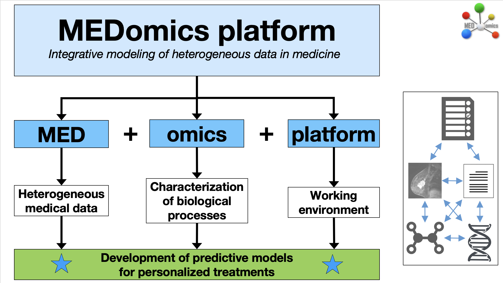
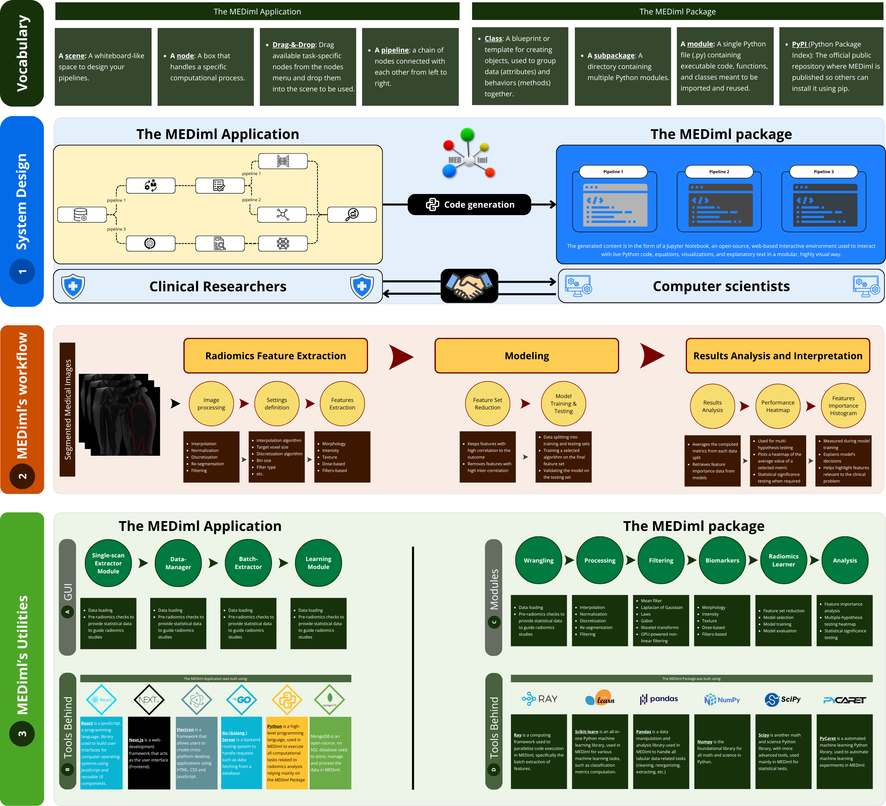
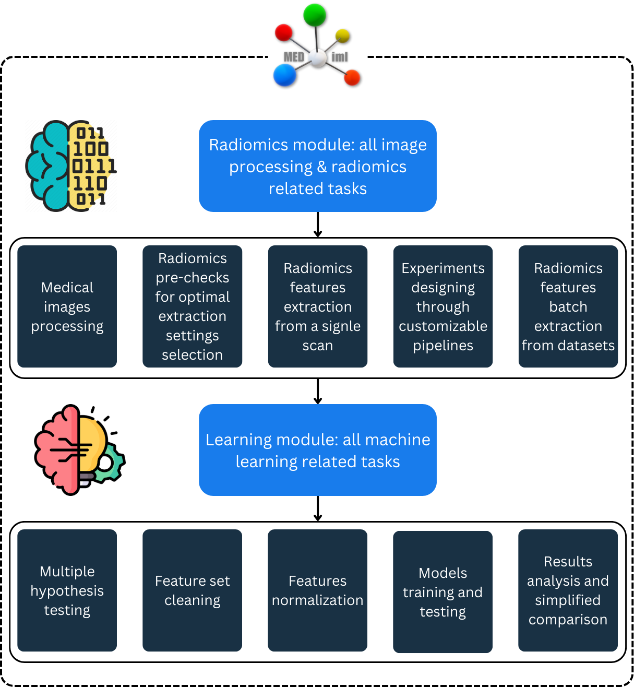

# 👋 Welcome!


**MEDimage is now MEDiml.**



This application represents the latest version of the radiomics module used in the MEDomics platform. We strive to keep both synchronized.


Welcome to the MEDiml-app documentation, where you will find all the resources you need to download, install, and use the application.

### MEDomics

This application is part of the [MEDomics ](https://medomics-udes.gitbook.io/medomicslab-docs)project. It provides a graphical user interface to interact with the [MEDiml package](https://github.com/MEDomics-UdeS/MEDimage), enabling users to extract radiomics features from medical images and analyze the data using machine learning models.

<figure><figcaption><p><em>MEDomics</em> overview</p></figcaption></figure>

### The MEDiml application

MEDiml stands for MEDical Image analysis with Machine Learning. It is an [IBSI](https://theibsi.github.io/)-
compliant open-source platform designed to improve the accessibility of radiomics for clinical researchers and
\
facilitate collaboration between multidisciplinary teams.

MEDiml provides a complexity-driven workflow that
&#x20;compares models built from progressively more complex radiomic feature sets, so that researchers can identify a compact feature set suited to a clinical question.&#x20;
_MEDiml-app_ shares the same computational framework as the [_MEDiml-pkg_](https://github.com/MEDomicsLab/MEDiml-pkg/), so that code generation exposes visually configured workflows as Python code that researchers can inspect and extend. The two interfaces therefore allow researchers with
&#x20;different programming experience to use the same analysis implementation. The following figure provides a full overview of MEDiml.

<figure><figcaption><p>Overview of the MEDiml application and Python package.</p></figcaption></figure>

### Our goal

The goal of the MEDiml app is to facilitate radiomics analyses for researchers from various disciplines and push for greater synergy among multidisciplinary teams. To achieve this, the application allows users to design their own experiments by customizing pipelines and defining specific settings. The back-end code is implemented in a modular way, ensuring easy adaptation and modification to meet diverse research needs. Additionally, users can generate Python code for their designed experiments, enabling reproducibility and further customization. With its intuitive interface and robust capabilities, the MEDiml app is designed to enhance research efficiency and collaboration. The following figure depicts the different parts of the app:

<figure><figcaption><p>MEDiml-app modules overview</p></figcaption></figure>

Before diving in, we recommend familiarizing yourself with the concepts of radiomics. You can read more about radiomics [here](radiomics/).

### Citing MEDiml

MEDiml and the scientific work done using the software have been published in multiple preprints, while the official paper is pending submission to the [Journal of Open Source Software](https://joss.theoj.org/) (JOSS).



_Submission to JOSS pending._

Read the preprint here:



```bibtex
@misc{2026medimlpaper,
      title         = {Medical Image Analysis with Machine Learning ({MEDiml}): Strategies for Simpler Radiomics},
      author        = {Ait Lhaj Loutfi, Mahdi and Provost, Simon and Gillard, \'Elodie and Bezzahi, Moustafa Amine and Chum, Alexander and Coull-Neveu, Ben and Duran, Juan and Kallel, Mariem and Laribi, Hakima and Lefebvre, Oliver and Longchamps, Nicolas and Nguyen, Thanh-Tri and Ravary, Steven and Sahbi, Ouael Nedjem Eddine and Dana, J\'er\'emy and Valli\`eres, Martin},
      year          = {2026},
      eprint        = {2610.37715},
      archivePrefix = {arXiv},
      primaryClass  = {eess.IV},
      url           = {https://arxiv.org/abs/2610.37715},
      doi           = {10.48550/arXiv.2610.37715}
}
```





```bibtex
@misc{2026medimlRefMan,
      title         = {Reference Manual of {MEDiml}},
      author        = {Ait Lhaj Loutfi, Mahdi and Provost, Simon and Gillard, \'Elodie and Bezzahi, Moustafa Amine and Chum, Alexander and Coull-Nveu, Ben and Juan, Duran and Kallel, Mariem and Laribi, Hakima and Lefebvre, Oliver and Longchamps, Nicolas and Nguyen, Thanh-Tri and Ravary, Steven and Sahbi, Ouael Nedjem Eddine and Dana, J\'er\'emy and Valli\`eres, Martin},
      year          = {2026},
      eprint        = {2610.29666},
      archivePrefix = {arXiv},
      primaryClass  = {cs.SE},
      url           = {https://arxiv.org/abs/2610.29666},
      doi           = {10.48550/arXiv.2610.29666}
}
```





```bibtex
@misc{2024medimlSciStudy,
      title         = {Unraveling Radiomics Complexity: Strategies for Optimal Simplicity in Predictive Modeling},
      author        = {Ait Lhaj Loutfi, Mahdi and Boblea Podasca, Teodora and Zwanenburg, Alex and Upadhaya, Taman and Barrios, Jorge and Raleigh, David R. and Chen, William C. and Capaldi, Dante P.I. and Zheng, Hong and Gevaert, Olivier and Wu, Jing and Silva, Alvin C. and Zhang, Paul J. and Bai, Harrison X. and Seuntjens, Jan and L\"ock, Steffen and Richard, Patrick O. and Morin, Olivier and Reinhold, Caroline and Lepage, Martin and Valli\`eres, Martin},
      year          = {2024},
      eprint        = {2407.04888},
      archivePrefix = {arXiv},
      primaryClass  = {eess.IV},
      url           = {https://arxiv.org/abs/2407.04888},
      doi           = {10.48550/arXiv.2407.04888}
}
```



### Contributing authors

The following table acknowledges all contributors who helped develop, maintain, test, and improve the application.

| Given Name          | Surname                 |
| ------------------- | ----------------------- |
| Simon               | Provost<sup>1</sup>     |
| Élodie              | Gillard<sup>2</sup>     |
| Moustafa Amine      | Bezzahi<sup>2</sup>     |
| Alexander           | Chum<sup>1</sup>        |
| Ben                 | Coull-Neveu<sup>1</sup> |
| Juan                | Duran<sup>1</sup>       |
| Mariem              | Kallel<sup>2</sup>      |
| Hakima              | Laribi<sup>2</sup>      |
| Oliver              | Lefebvre<sup>2</sup>    |
| Nicolas             | Longchamps<sup>2</sup>  |
| Thanh-Tri           | Nguyen<sup>1</sup>      |
| Steven              | Ravary<sup>1</sup>      |
| Ouael Nedjem Eddine | Sahbi<sup>2</sup>       |
| Jérémy              | Dana<sup>3</sup>        |
| Martin              | Vallières<sup>1,2</sup> |

1. _Medical Physics Unit, Department of Oncology, McGill University, Montréal, Canada_
2. _Department of Computer Science, Université de Sherbrooke, Sherbrooke, Canada_
3. _Department of Radiology, Centre de Recherche du Centre Hospitalier de l'Université de Montréal, Montréal, Canada_

### Quick documentation guide

* To download and install the application, go to the [next page](quick-start.md).
* For tutorials, refer to the [radiomics page](radiomics/).
* Use the [_Forms_ ](https://app.gitbook.com/s/WC0t7nEhhoOT73GRY714/forms)section to contact us or to report an issue.
* The [_Media_ ](https://app.gitbook.com/s/WC0t7nEhhoOT73GRY714/media)section contains all our communication and interaction websites.
* If you are ready to add your touch to our application, refer to the [contribution page](contributing.md).
