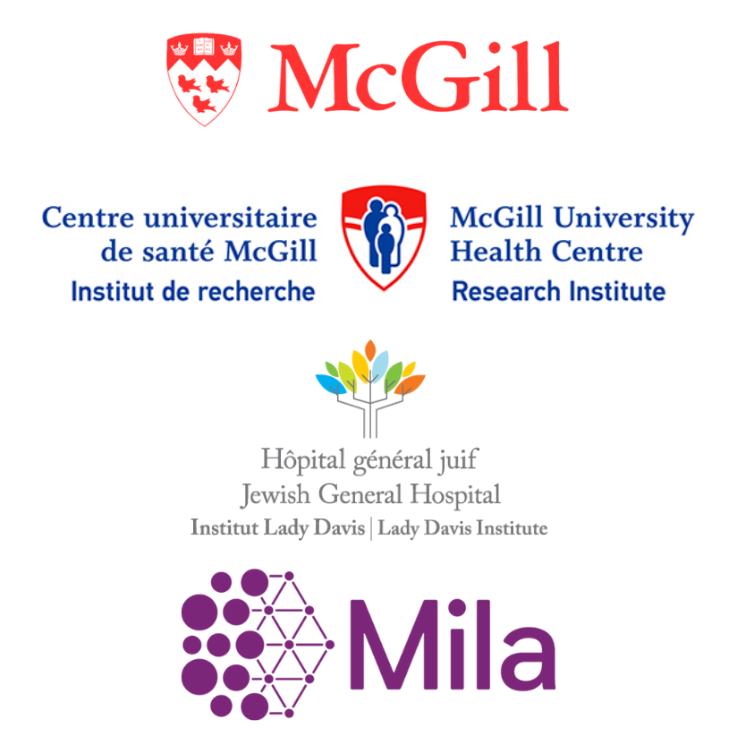

# About us

## About us

<table data-card-size="large" data-view="cards"><thead><tr><th></th><th></th><th></th><th></th><th></th><th data-type="content-ref"></th><th></th><th data-type="files"></th></tr></thead><tbody><tr><td></td><td><h2><strong>Martin Vallières, PhD</strong></h2></td><td>
Associate Professor,

Medical Physics Unit, Gerald Bronfman Department of Oncology,

McGill University

Investigator — Research Institute of the McGill University Health Centre
</td><td>Investigator — Lady Davis Institute for Medical Research</td><td>Associate Academic Member — Mila - Quebec AI Institute</td><td></td><td><a href="https://www.medomicslab.com/">https://www.medomicslab.com/</a></td><td></td></tr><tr><td></td><td><h2>Mahdi Loutfi, MSc</h2></td><td>PhD Candidate</td><td>
Medical Physics Unit, Gerald Bronfman Department of Oncology,

McGill University
</td><td>Mila - Quebec AI Institute</td><td></td><td><a href="https://www.medomicslab.com/">https://www.medomicslab.com/</a> </td><td></td></tr></tbody></table>

​​​

### Former Contributors

<table data-view="cards"><thead><tr><th></th><th></th><th></th><th></th><th></th><th></th><th data-hidden></th><th data-hidden data-type="content-ref"></th><th data-hidden data-type="content-ref"></th></tr></thead><tbody><tr><td><h3></h3><h3>Andréanne Allaire</h3></td><td><h4>Developer</h4></td><td>Research Assistant</td><td>Université de Sherbrooke</td><td></td><td></td><td></td><td></td><td></td></tr></tbody></table>

### Former Interns​​​​ 

<table data-card-size="large" data-view="cards"><thead><tr><th></th><th></th><th></th><th></th><th></th></tr></thead><tbody><tr><td></td><td><h2>Corentin Gauthier</h2></td><td><h4>Ex-Intern</h4></td><td>Université de Sherbrooke</td><td></td></tr><tr><td></td><td><h2>Clarisse Cheng</h2></td><td><h4>Ex-Intern</h4></td><td>Université de Sherbrooke</td><td></td></tr></tbody></table>

### 🤝Partners 

​​​​​​​​​​​​​

<table data-view="cards"><thead><tr><th></th><th></th><th></th></tr></thead><tbody><tr><td></td><td></td><td></td></tr></tbody></table>
