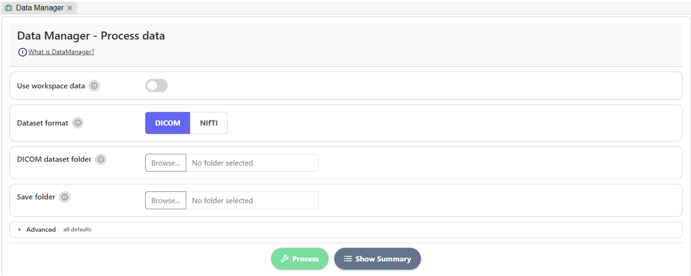

# Data Manager


A tutorial video is available at the bottom of the page.


The `DataManager` class plays an important role in `MEDiml`. The class is capable of processing raw [DICOM](https://en.wikipedia.org/wiki/DICOM) and [NIfTI](https://brainder.org/2012/09/23/the-nifti-file-format/) data and converting it into binary objects that will be used by `MEDiml`.

<figure><figcaption>
<em>DataManager</em> Page - Data Processing section
</figcaption></figure>

### How to Process Data


This is only recommended for large-scale radiomics analysis where multiple experiments will be done.


**Process Data** section converts your imaging dataset (DICOM or NIfTI) into MEDscan objects (`.npy`). MEDiml needs these files for the pre-checks and the feature extraction that follow.

#### Steps

1. **Use workspace data** _(optional)_: turn on to pick folders from the current workspace (the explorer on the left) instead of from your disk.
2. **Dataset format**: choose **DICOM** or **NIfTI**.
3. **Dataset folder**: select the folder that holds your dataset (see the format requirements below).
4. **Save folder**: select where the `.npy` files will be written.
5. **Advanced → Cores** _(optional)_: the number of CPU cores used for the conversion. The default is 12.
6. Click **Process**. A progress bar shows each stage, and a message confirms when processing is done.
7. Click **Show Summary** to see what was found and converted.

#### Dataset format requirements



Use the standard layout: **one folder per patient**, with **one sub-folder per imaging scan**.



File names must follow the MEDiml naming convention so scans and their masks can be paired:

`PatientID__ImagingScanName(ROIname).Modality.nii.gz`



Please check [this link](https://mediml.readthedocs.io/en/latest/input_data.html) for more details.


When processing finishes, the save folder is used automatically as the input for the [**Radiomics Pre-checks** section](radiomics-pre-checks.md), and its study, institution, and modality filters are filled from your data.



**Process** stays disabled until both a dataset folder and a save folder are selected.


### Tutorial video 


