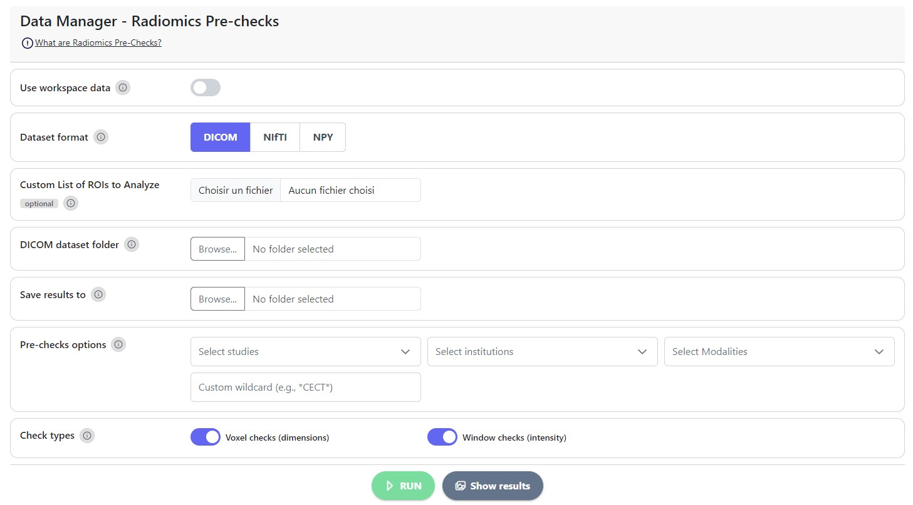

# Radiomics Pre-Checks


A tutorial video is available at the bottom of the page.


Since high variation in imaging parameters will impact the robustness of radiomic features, the following code will assist you in identifying optimal intensity ranges and voxel dimension re-scaling parameters for a specific dataset. For further insights, refer to the following [article](https://doi.org/10.1016/j.ejmp.2021.07.023), which examines how intensity windows affect the stability of radiomic features in CT data.

<figure><figcaption>
<em>DataManager</em> Page - Radiomics Pre-checks section
</figcaption></figure>

### How to Run Radiomics Pre-Checks

**Radiomics pre-checks** scan your dataset before extraction and report the **voxel dimensions** and **intensity** ranges across your scans. Use them to choose sensible extraction settings, such as voxel size and re-segmentation range.

#### Steps

1. **Use workspace data** _(optional)_: turn on to pick the dataset and ROI CSV from the current workspace instead of from your disk.
2. **Dataset format**: choose **DICOM**, **NIfTI** or **NPY**. NPY is the MEDscan output of **Process data**.
3. **Custom List of ROIs to Analyze** _(optional)_: a CSV listing the ROIs to check. Leave it empty to use the union of all ROIs.
4. **Dataset folder**: select the folder to check.
5. **Save results to**: select where the plots and JSON summaries will be written.
6. **Pre-checks options**: choose which scans to check (see below).
7. **Check types**: turn **Voxel checks (dimensions)** and/or **Window checks (intensity)** on. Both are on by default.
8. Click **RUN**, then **Show results** to view the plots.

#### Choosing which scans to check



When you select an NPY folder, the **studies**, **institutions** and **modalities** found in the file names fill the three lists. Pick one or more values in any list. Empty lists match everything.


The lists are read from file names such as `STUDY-INSTITUTION-ID__scan.Modality.npy`. After **Process data**, its save folder is selected here automatically.




Type a file-name pattern instead, for example `*CECT*` or `STS*CECT*.npy`. A custom wildcard **replaces** the filters. Use it for DICOM or NIfTI folders, where the lists stay empty.




**RUN** stays disabled until at least one filter value or a custom wildcard is given and at least one check type is on.


### Tutorial video 


