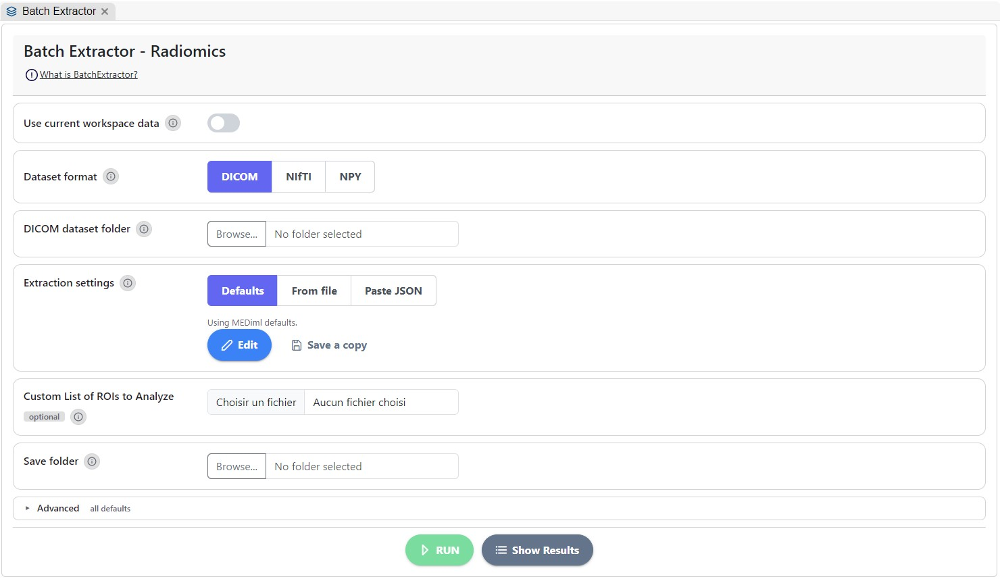
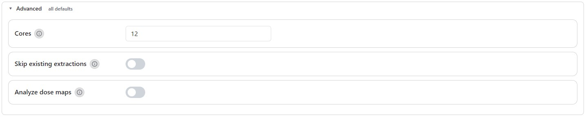

# Batch Extraction


A tutorial video is available at the bottom of the page.


In our software, batch extraction of features follows the workflow outlined in the[ initial chapter of the IBSI](https://pubs.rsna.org/doi/10.1148/radiol.2020191145). This approach limits user control over processing steps and feature selection, requiring any adjustments to be made in the back-end code. This limitation is implemented to ensure that Radiomics analysis of datasets aligns with international standards.

The _Batch Extraction_ page is dedicated to extracting features from datasets. This process involves a preprocessed dataset of [MEDscan objects](https://medimage.readthedocs.io/en/latest/tutorials.html#medscan-class), a [CSV file](https://medimage.readthedocs.io/en/latest/csv_file.html) containing information about the regions of interest (ROIs) to be analyzed, and, lastly, a [JSON settings file](https://medimage.readthedocs.io/en/latest/configurations_file.html).

<figure><figcaption>
The BatchExtractor Page
</figcaption></figure>

The extraction process utilizes parallelization through the [Ray ](https://www.ray.io/)Python library. Users can control the number of cores allocated for this step; a higher number leads to faster extraction. However, extraction time is contingent on the size of the dataset.

### How to Use The Batch Extractor

The **Batch Extractor** computes radiomics features for every scan in a dataset and saves them as feature tables in your save folder.

#### Steps

1. **Use current workspace data** _(optional)_: turn on to pick the dataset, ROI CSV and settings from the current workspace instead of from your disk.
2. **Dataset format**: choose **DICOM**, **NIfTI** or **NPY**. NPY is the [MEDscan](https://medimage.readthedocs.io/en/latest/tutorials.html#medscan-class) output of the DataManager.
3. **Dataset folder**: select the folder to extract features from.
4. **Extraction settings**: MEDiml's defaults are loaded and ready to use. Change them only if your study protocol calls for it (see below). Extraction settings impact the extracted features; read more about this [here](https://mediml.readthedocs.io/en/latest/configurations_file.html).
5. **Custom List of ROIs to Analyze** _(optional)_: a [CSV listing](https://mediml.readthedocs.io/en/latest/csv_file.html) the ROIs to extract. Leave it empty to use the union of all ROIs.
6. **Save folder**: select where the results go. A sub-folder is created per ROI type.
7. **Advanced** _(optional)_: see Advanced settings.
8. Click **RUN**, then **Show Results** to list the result files and open the folder.

#### Extraction settings

The settings tell MEDiml how to prepare each image and which features to compute. One set covers CT, MR and PET: MEDiml uses the section that matches each scan's modality.



MEDiml's reference settings. Nothing to do: the defaults are a sound starting point for most studies.



Load a settings `.json` file from the workspace or your disk. The file is checked before it is used, and any problem is shown under the card.



Paste the settings as JSON, or as a Python dict copied from a notebook, then click **Use these settings**.



Whatever the source:

* **Edit** opens the settings editor: essentials first, one tab per modality, plus a **Filtering** tab. Click **Apply** to use your changes, or **Cancel** to discard them.
* **Undo edits** goes back to the settings as loaded.
* **Save a copy** saves the current settings as a `.json` file for later studies.


**Reproducibility:** every run saves the exact settings it used as `extraction_settings.json` in the save folder. Keep it with your results and report it in your methods.



**RUN** stays disabled until a dataset folder and a save folder are selected. With **Analyze dose maps** on, a prescribed doses CSV and a dose column name are also required.


#### Advanced settings

<figure><figcaption>
The BatchExtractor's advanced settings
</figcaption></figure>

**On the page**

| Setting                       | What it does                                                                                                                                                                                     |
| ----------------------------- | ------------------------------------------------------------------------------------------------------------------------------------------------------------------------------------------------ |
| **Cores**                     | Number of CPU cores used in parallel (default 12). More cores is faster but uses more memory.                                                                                                    |
| **Skip existing extractions** | Skips scans whose features are already in the save folder. Useful to resume an interrupted run.                                                                                                  |
| **Analyze dose maps**         | Extracts dose features (dosiomics) from RT dose maps. Requires a **Prescribed doses CSV** with a `PatientID` column, and the **Dose column name** holding each patient's prescription dose (Gy). |


For dose features, also turn on **Dose** under **Feature families** in **Extraction settings → Edit**.


**In the settings editor**

The essentials in each modality tab are **Voxel size**, **Re-segmentation**, **Discretisation**, **Filter** and **Feature families**. Everything below is folded under **Advanced** in each tab; the number next to it counts the values you changed from the defaults.

| Setting                             | What it does                                                                                                     |
| ----------------------------------- | ---------------------------------------------------------------------------------------------------------------- |
| **Bounding box**                    | Crops around the ROI before processing: `full`, `box`, `box10` (10-voxel margin) or `2box` (twice the ROI size). |
| **Compute SUV map** _(PET)_         | Converts PET to SUV. DICOM only; NIfTI PET must already be in SUV.                                               |
| **Image interpolation**             | Method used to resample the image to the voxel size.                                                             |
| **ROI interpolation**               | Method used to resample the ROI mask.                                                                            |
| **ROI partial volume**              | Share of a resampled voxel (0 to 1) that must lie in the ROI to keep it.                                         |
| **Grey level rounding**             | Rounds intensities to this power of 10 after resampling (CT). Leave empty to skip.                               |
| **Intensity-volume histogram**      | Binning for intensity-volume histogram features. **None** keeps raw intensities.                                 |
| **Dose mask extension** _(Dose on)_ | Margin around the ROI box: a number of voxels, or a fraction between 0 and 1.                                    |
| **Vx thresholds** _(Dose on)_       | Doses (Gy) for the Vx volume features, comma separated.                                                          |


Settings change the feature values. Keep them identical for every patient in a study.


### Tutorial video 


