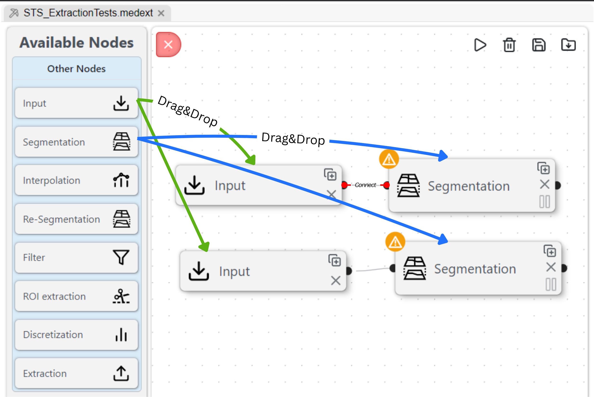
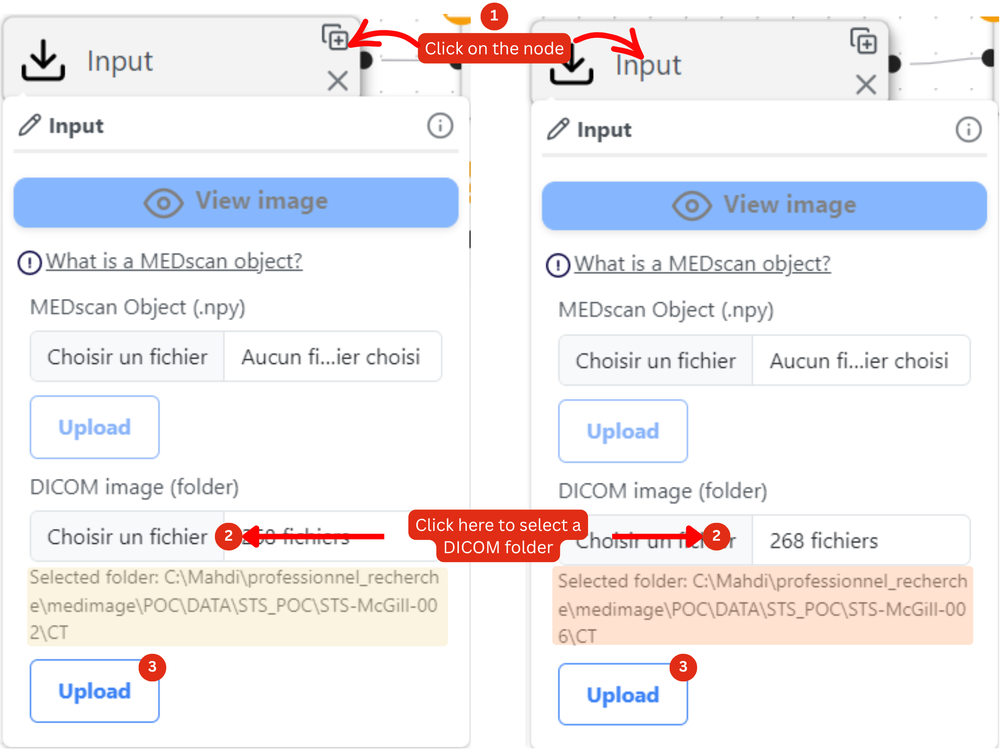
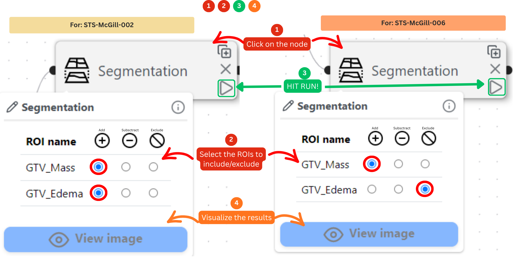
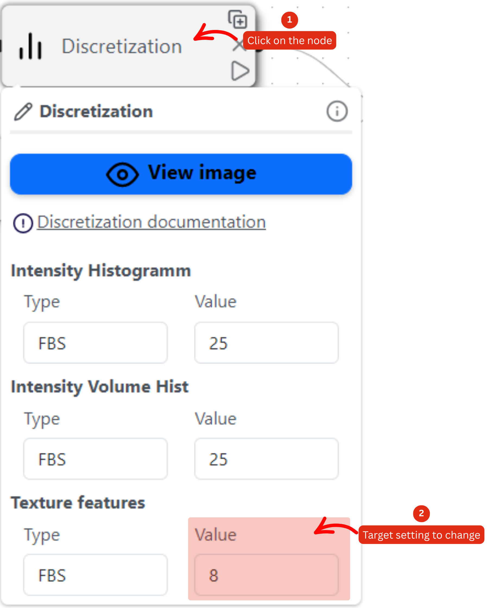
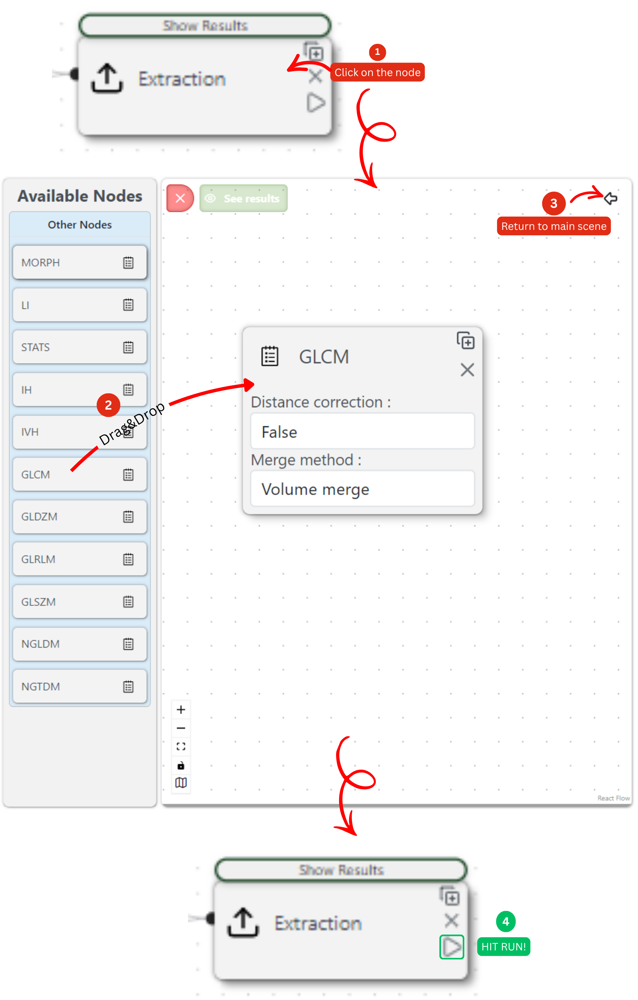
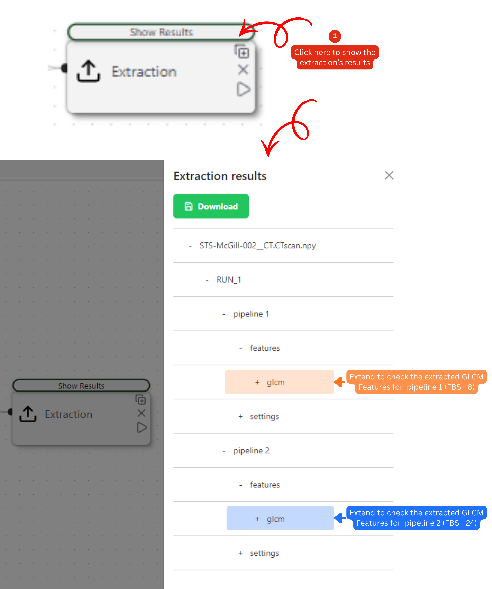

# 1. Single Scan Extraction

### Preface

The [**Single-Scan Extraction Module**](../radiomics/feature-extraction/single-scan.md) in MEDiml is designed for exploratory analysis and educational purposes. It provides an interactive environment where users can visualize regions of interest (ROIs), experiment with different radiomics extraction settings, and observe how these choices influence the resulting features.

Before launching large-scale computations, we will inspect a small number of patient scans, visualize their tumor regions, and examine how radiomics extraction parameters affect the generated features to highlight the importance of this exploratory module.

### Setup

* Using the sidebar on the left, open **MEDiml Modules → Extraction Module**, enter the scene name

```
STS_ExtractionTests 
```

and click Start Extraction.&#x20;

<figure><figcaption></figcaption></figure>

* Drag **two Input nodes** and **two Segmentation nodes** into the scene.
* Connect each Input node to a Segmentation node, creating two independent pipelines.
* We will use two example scans:
  1. `STS-McGill-002` : patient without metastasis during follow-up (**Outcome = 0**)
  2. `STS-McGill-006` : patient with metastasis during follow-up (**Outcome = 1**)

<figure><figcaption></figcaption></figure>

Using patients from different outcome groups allows us to visually compare scans before performing radiomic analysis.

#### Preliminary Visualization

The objective of this section is simply to familiarize ourselves with the dataset and inspect the annotated tumor regions.

**Load the Images**

For each Input node:

1. Select **DICOM Image (Folder)** from the workspace.
2. Choose the corresponding CT scan directory.
3. Click **Upload**.

<figure><figcaption></figcaption></figure>

Once the image is loaded, the available ROIs will automatically appear in the connected Segmentation node.

**Select ROIs**

* For `STS-McGill-002/CT` select: _GTV\_Mass_ and _GTV\_Edema_
* For `STS-McGill-006/CT` select: _GTV\_Mass_

<figure><figcaption></figcaption></figure>

**Visualize the Segmentations**

_MEDiml offers a full 3D visualization tool that opens in an external window._

1. Click **Run** on each Segmentation node.
2. Click **View Image** for each patient.
3. Examine the tumor contours and surrounding anatomy.



<figure><figcaption></figcaption></figure>



<figure><figcaption></figcaption></figure>



At this stage, do not worry about identifying subtle imaging biomarkers. The goal is simply to become familiar with the data and observe whether any obvious visual differences exist between patients from different outcome groups _(unless you are a radiologist..._:laughing:_)_.

#### Understanding the Impact of Extraction Parameters

Radiomics converts medical images into quantitative features that describe characteristics such as intensity distributions, texture patterns, and shape. Importantly, the values of these features can depend strongly on preprocessing and extraction settings.

In this section, we will explore how changing a single parameter can alter the resulting radiomic features.

**Extend the Pipelines**

Add the following nodes to a pipeline of your choice:

```
Input → Segmentation → Interpolation → ROI Extraction → x2 Discretization → Extraction
```

<figure><figcaption></figcaption></figure>

Leave all node settings at their default values except for the <mark style="color:$danger;">**Two**</mark>**&#x20;Discretization** nodes.

> **What is Discretization?** It is the process of mapping a continuous range of image intensities into a discrete, finite set of digital values. Two approaches to discretisation are commonly used. One involves the discretisation to a fixed
> &#x20;number of bins (intensities are discretised to a fixed number), and the other discretisation with a fixed bin width (a new bin is assigned for each intensity interval with the specified size). [Read more](https://arxiv.org/abs/1612.07003).

**First Discretization Node:** Use fixed bin size (FBS)

```
Type: FBS
Value: 8
```

**Second Discretization Node:** Use fixed bin number (FBN)

```
Type: FBS
Value: 24
```

<figure><figcaption></figcaption></figure>

**Select the Feature Family**

1. Click on the **Extraction** node to open it.
2. Drag the **GLCM** node into the scene.
3. Click **Go Back**.

This configures the pipeline to extract **Gray Level Co-occurrence Matrix (GLCM)** texture features, which quantify patterns of spatial intensity variation within the tumor.

Now, click **Run** on the Extraction node.

<figure><figcaption></figcaption></figure>

#### Exploring the Results

When both runs have completed:

1. Click **Show Results** at the top of the Extraction node.
2. Select the processed scan.
3. Compare the outputs from:
   * **pipeline\_1**
   * **pipeline\_2**

<figure><figcaption></figcaption></figure>

You should observe that many feature values differ between the two runs, despite the underlying image and tumor region remaining unchanged:

| pipeline\_1 (FBS - 8)                                                                                                                                                                                                              | pipeline\_2 (FBS - 24)                                                                                                                                                                                               |
| ---------------------------------------------------------------------------------------------------------------------------------------------------------------------------------------------------------------------------------- | -------------------------------------------------------------------------------------------------------------------------------------------------------------------------------------------------------------------- |
| <p>Fcm_joint_max: <mark style="color:$primary;">0.08801279701403006</mark> Fcm_joint_avg: <mark style="color:$primary;">31.585257884271453</mark></p><p>Fcm_joint_var: <mark style="color:$primary;">11.720108593974924</mark></p> | <p>Fcm_joint_max: <mark style="color:pink;">0.014041168171871008</mark> Fcm_joint_avg: <mark style="color:pink;">97.625215227558</mark></p><p>Fcm_joint_var: <mark style="color:pink;">113.31378038407667</mark></p> |

This occurs because discretization determines how image intensities are grouped before texture calculations are performed. Different discretization settings therefore produce different representations of the same tumor and can lead to substantially different radiomic feature values.

This example highlights an important principle in radiomics: **feature values are often sensitive to extraction parameters**. Careful parameter selection is therefore critical when developing robust predictive models.

Fortunately, MEDiml supports the simultaneous evaluation of multiple extraction configurations. During model development, feature-selection procedures can then identify which features and parameter combinations provide the greatest predictive value.

#### Exploring Image Filters (Optional)

This section is outside the scope of the POC but is recommended for users who wish to further explore image preprocessing.

Image filters can emphasize specific characteristics of medical images, such as edges, fine textures, or intensity gradients. In some clinical applications, appropriate filtering can reveal patterns that are difficult to observe in the original image.

To experiment with filters:

1. Create additional pipelines.
2. Add a **Filter** node to each pipeline.
3. Configure a different filter in each pipeline.
4. Click the scene's global **Run** button (top-right corner).

After processing is complete:

1. Open **View Image** on each Filter node.
2. Compare the filtered images.
3. Observe which filters best highlight structures that may be relevant to your clinical or research question.

There is no universally optimal filter. The most suitable choice depends on the imaging modality, biological phenomenon of interest, and predictive task being addressed.
