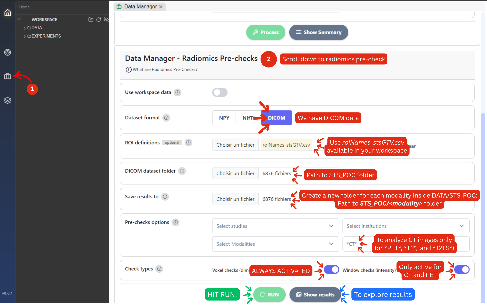
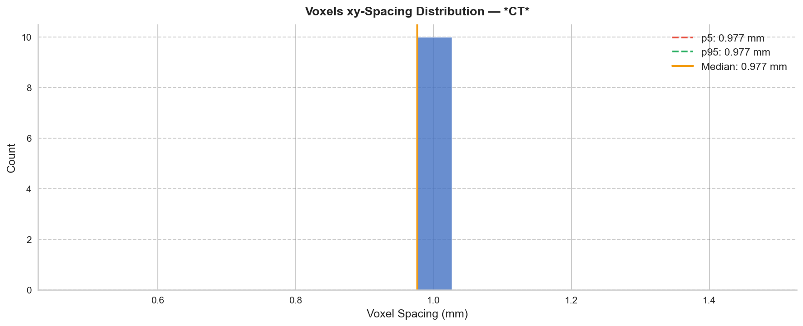
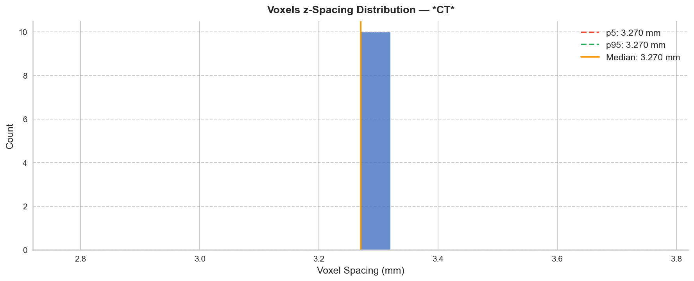
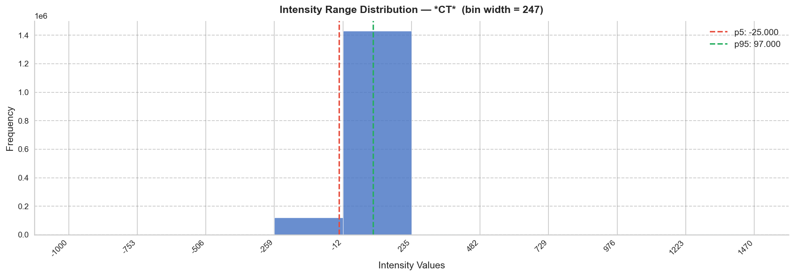
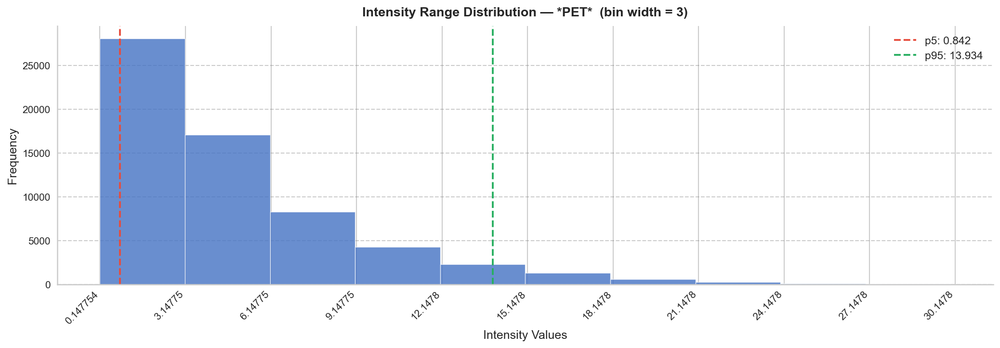

# 2. DataManager: Radiomics pre-checks

### Purpose

As demonstrated in the first phase of the PoC, extraction settings choices affect the feature values. Therefore, before extracting radiomics features from the entire dataset, it is important to identify appropriate preprocessing settings.

The [**Radiomics Pre-Checks**](../radiomics/data-processing/radiomics-pre-checks.md) module provides a quick overview of key image characteristics across the dataset, including:

* Voxel spacing and image resolution
* Intensity distributions within the selected tumor ROI

These observations will guide the selection of interpolation, re-segmentation, and discretization parameters used during batch radiomics extraction.

### Running the Pre-Checks

Open: **Data Manager → Radiomics Pre-Checks**

Use the following settings:

* **Dataset format:** DICOM
* **ROI definitions:** `roiNames_stsGTV.csv`
* **Dataset folder:** `DATA/STS_POC`
* **Save folder:** Save each modality's results to a separate folder `DATA/STS_POC/CT`, `DATA/STS_POC/PET`, etc.
* **Check types:**
  * Voxel Checks (Dimensions)
  * Window Checks (Intensity): Optionally, you can only activate it for CT and PET imaging modalities.


**VERY IMPORTANT**: When creating a new save folder for each new result, make sure you place an empty document inside the folder for it to be selectable in MEDiml. **Empty folders are not selectable in MEDiml.**



**To save you time:** The voxel-dimension pre-check results are the same across CT, T1, and T2FS. So you can only run the pre-check analysis for CT and PET.


Run the analysis **once per modality,** changing the custom wildcard in the Pre-checks options to:

* \*CT\*
* \*PET\*
* \*T1\*
* \*T2FS\*

<figure><figcaption></figcaption></figure>

### What to Look For

Select a tab based on which POC data you decided to download:



**Voxel Checks (CT, T1, and T2FS)**

These plots show the spatial resolution of the images across patients. Their main purpose is to help determine an appropriate **isotropic voxel size** (equal across the three dimensions) for radiomics extraction.

XY-dimensions:

<figure><figcaption></figcaption></figure>

Z-dimension:

<figure><figcaption></figcaption></figure>

In general, the selected voxel size should be close to the modality's typical image resolution and not substantially finer than the native acquisition resolution. Upsampling requires
&#x20;inference and introduces artificial information, while conversely downsampling to the largest dimension incurs information loss; hence, a good trade-off must be determined.


**Based on the plots above, 2x2x2 seems a good trade-off.**


**Intensity Checks - CT**

These outputs summarize intensity values inside the tumor ROIs.

They can help identify:

* Suitable re-segmentation ranges
* Appropriate gray-level discretization settings
* Differences in intensity behavior between CT, PET, and MR images

<figure><figcaption></figcaption></figure>

The Hounsfield Unit (HU) Density Scale:

> Our goal is to use the pre-checks plot to exclude all HUs indicating air and bone tissue in the tumor and keep only soft tissue.


The HU scale is a quantitative scale used in Computed Tomography (CT) scanning to describe radiodensity, or how easily X-rays pass through different tissues. It provides a standardized way for radiologists to identify tissues, fluids, and abnormalities based on their density.


<figure><figcaption>
The hounsfield unit CT density scale.
</figcaption></figure>

According to the intensity distribution analysis, 90% of the voxel intensities within the selected ROIs fall between approximately **-25 HU (5th percentile)** and **97 HU (95th percentile)**. In addition, the majority of soft tissues are typically represented by positive Hounsfield Unit values, commonly within the range of approximately **40-100 HU**. We therefore selected a conservative re-segmentation range of **0 to 100 HU**, which captures most of the observed intensity distribution while focusing on values representative of soft tissue. This range also helps reduce the influence of lower-intensity voxels that are less likely to contain clinically relevant tumor information.


A **\[0, 100]** HU range is selected.


***

**Voxel Checks  - PET**

XY-dimensions:

<figure><figcaption></figcaption></figure>

Z-dimensions:

<figure><figcaption></figcaption></figure>


**Based on the plots above, 4x4x4 seems a good trade-off.**


**Intensity Checks - PET**

_What values do PET images hold?_ The images created from PET scans have bright spots and dark spots. The measurement of brightness is the SUV number. In general, higher SUV numbers may indicate a malignancy, or cancerous growth. [Read more](https://www.mdanderson.org/cancerwise/standardized-uptake-value--suv--numbers-on-pet-scans--what-do-they-mean.h00-159698334.html).


In PET radiomics, re-segmentation is commonly used to exclude low-activity voxels that may represent background signal, noise, or non-metabolically active regions. Typical approaches involve defining either a fixed SUV interval (e.g., \[a,b]) or a minimum SUV threshold (e.g., \[a,∞\[) to focus the analysis on biologically relevant tracer uptake.


<figure><figcaption>
PET images intensity distribution
</figcaption></figure>

According to the intensity distribution analysis, 90% of the PET voxel intensities within the selected ROIs fall between approximately **0.84 SUV** and **13.93 SUV**. Since only a small proportion of voxels exhibit values below 1 SUV, we selected a conservative re-segmentation range of **1 to 14 SUV**. This range closely matches the central intensity distribution while preserving the vast majority of tumor uptake information and reducing the influence of extreme intensity values.


A **\[1, 14]** SUV range is selected.








#### Summary

Here is a summary table containing the selected settings:

* Voxel size (per modality)
* Re-segmentation range (if applicable)
* Discretization method and parameters

These settings will be reused throughout the remainder of the POC to ensure a consistent radiomics workflow.

| Parameter                | Where is it used? | Light POC                                                                                                                                                                                                                                                 | Full POC                                                                                                                                                                                                                                        |
| ------------------------ | ----------------- | --------------------------------------------------------------------------------------------------------------------------------------------------------------------------------------------------------------------------------------------------------- | ----------------------------------------------------------------------------------------------------------------------------------------------------------------------------------------------------------------------------------------------- |
| Voxel size               | Interpolation     | 2x2x2                                                                                                                                                                                                                                                     | 2x2x2                                                                                                                                                                                                                                           |
| Re-segmentation range    | Re-segmentation   | <ul><li>CT: <strong>[0, 100]</strong> HU</li><li>PET: <strong>[1, 14]</strong> SUV</li><li>T1 and T2FS: Raw values are kept</li></ul>                                                                                                                     | <ul><li>CT: <strong>[0, 100]</strong> HU</li><li>PET: <strong>[1, 14]</strong> SUV</li><li>T1 and T2FS: Raw values are kept</li></ul>                                                                                                           |
| Discretization algorithm | Discretization    | <ul><li>CT and PET: <strong>FBN</strong> &#x26; <strong>FBS</strong></li><li>T1 and T2FS: <strong>FBN</strong> only</li></ul>                                                                                                                             | <ul><li>CT and PET: <strong>FBN</strong> &#x26; <strong>FBS</strong></li><li>T1 and T2FS: <strong>FBN</strong> only</li></ul>                                                                                                                   |
| Discretization value     | Discretization    | <ul><li>CT and PET - FBN <strong>8, 16, 32 and 64</strong></li><li>PET - FBS: <strong>1.75, 0.875, 0.4375, 0.21875</strong></li><li>CT - FBS: <strong>12.5, 6.25, 3.125, 1.5625</strong></li><li>T1 and T2FS: <strong>8, 16, 32 and 64</strong></li></ul> | 

<ul><li>CT and PET - FBN <strong>8, 16, 32 and 64</strong></li><li>PET - FBS: <strong>1.75, 0.875, 0.4375, 0.21875</strong></li><li>CT - FBS: 12.5, 6.25, 3.125, 1.5625</li><li>T1 and T2FS: <strong>8, 16, 32 and 64</strong></li></ul> |

_We are now ready for the "most radiomic" step in this POC: feature extraction_ :fire:_!_
