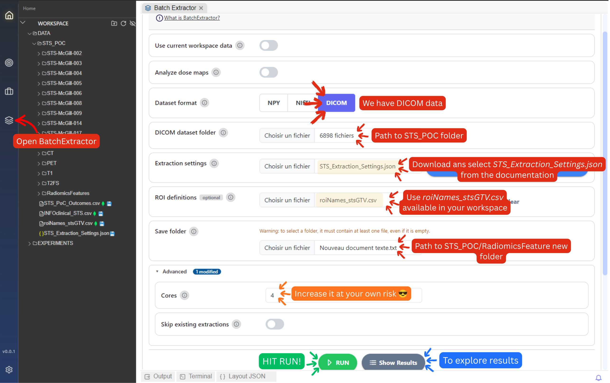
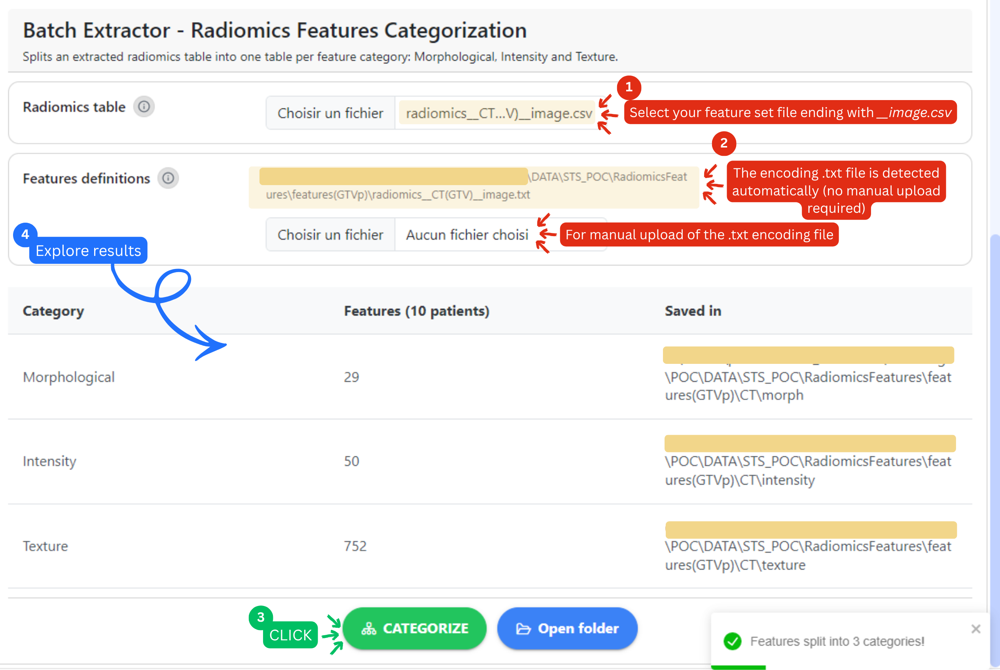

# 3. BatchExtractor

### Purpose

After identifying suitable preprocessing and extraction settings during the **Radiomics Pre-Checks** phase, the next step is to extract radiomics features from the entire dataset.

The [**Batch Extractor**](../radiomics/feature-extraction/batch-extraction.md) automates this process by applying the same radiomics pipeline to all patients and imaging modalities, ensuring a consistent and reproducible feature extraction workflow.

### Configure the Extraction


As promised, the extraction settings file can be downloaded in this section!


From the left sidebar, open **Batch Extractor** (stacked layers icon)

Use the following inputs:

* **Dataset format:** DICOM
* **Dataset folder:** `DATA/STS_POC`
* **Extraction settings**: please download the extraction settings file and place it under `/DATA`



* **ROI definitions:** `roiNames_stsGTV.csv`
* **Output folder:** create a new folder `DATA/STS_POC/RadiomicsFeatures`


**REMINDER**: When creating a new save folder, make sure you place an empty document inside the folder for it to be selectable in MEDiml. **Empty folders are not selectable in MEDiml.**


For this POC, configure the extraction parameters using the settings selected during the **Radiomics Pre-Checks** phase:

* Interpolation voxel size
* Re-segmentation range
* Discretization method and value

**Advanced settings:**

* **Cores**: Number of CPU cores used for the parallel extraction of features. Set it according to the resources available to you. **Recommended: 4 cores.**
* **Skip existing extractions**: Ignore.

To keep the workflow simple, we will extract:

* Morphological features
* Intensity features
* Texture features (GLCM, GLRLM, GLSZM, NGTDM, and GLDM)

for all four imaging modalities:

* CT
* PET
* T1
* T2FS

<figure><figcaption></figcaption></figure>

### Run the Extraction

Once the configuration is complete:

1. Click **Run Extraction**.
2. Wait for the process to finish. (Light POC: \~30 minutes; Full POC: \~2 hours).
3. Inspect the extraction logs to verify that all patients were processed successfully.

Depending on whether you selected the **Light POC** (10 patients) or the **Full POC** (51 patients), the extraction may take from a few minutes to substantially longer.

### Output Files

Once complete, MEDiml generates one radiomics feature table per modality.

Typical outputs include:

CT\_features.csvPET\_features.csvT1\_features.csvT2FS\_features.csv

Each row corresponds to a patient, while each column represents a radiomics feature extracted from the selected ROI.

These feature tables will serve as the input for the machine-learning experiments performed in the next phase.

You are now ready to move to the **Learning Module**, where these features will be used to train and evaluate models predicting the development of lung metastases.

### Feature Categorization

In the **Learning Module**, we will use the **feature complexity framework** introduced in the [MEDiml methodology](https://arxiv.org/abs/2407.04888v1) to evaluate how different types of radiomic information contribute to the prediction of lung metastasis. To do so, separate machine-learning models will be trained using different feature categories, and their performance will be compared.

The feature categories analyzed in this POC are:

* **Morphological features:** Describe the three-dimensional shape and geometric properties of the tumor, such as its volume, surface area, and compactness.
* **Intensity features:** Describe the distribution of voxel intensities within the tumor, providing information about overall signal levels and intensity variability.
* **Texture features:** Quantify spatial patterns and heterogeneity within the tumor, capturing relationships between neighboring voxel intensities that may not be visible to the naked eye.

By comparing models trained on these different feature groups, we can gain insight into which type of imaging information is most relevant for the clinical prediction task.

#### Categorizing the Feature Sets&#x20;


Apply 4 times, one for each imaging modality: CT, PET, T1, and T2FS.


MEDiml currently extracts all radiomics features into a single feature set. To facilitate downstream analysis, features must first be separated into their respective categories using the **Categorization** tool available in the **Batch Extractor** module.

To categorize a feature set:

1. Load the extracted feature set (`.csv`) for a given imaging modality (`radiomics__CT(GTV)__image.csv`, for example).
2. Load the corresponding feature encoding file (`.txt`), usually it is detected automatically. The file has the same name as the .csv file (`radiomics__CT(GTV)__image.txt` for example).
3. Click **Categorize**.

Once the process is complete, MEDiml will automatically create a subfolder for each feature category within the feature set directory. Each subfolder will contain a new feature set containing only the features belonging to the corresponding category.

<figure><figcaption></figcaption></figure>

WE are now ready for the next phase to train and compare machine-learning models based on different levels of radiomic feature complexity :fire:.
