# 4. Learning Module

### Ending the Full vs Light version inequality :fist:

Since we are done using our imaging volumes, we only need the extracted feature sets. Download the **Full POC feature sets** here:


Please extract this zip file into a new folder `DATA/STS_POC/RadiomicsFeatures` in your workspace, and you should be set for the most crucial step of this POC.




### Purpose

The goal of this phase is to transform the radiomics features extracted in the previous steps into predictive models capable of identifying patients at risk of developing lung metastases.

Unlike the earlier stages, which focused on image processing and feature generation, the Learning Module focuses on answering two key scientific questions:

1. **Which imaging modality contains the strongest predictive signal?**
2. **Which radiomics feature family contributes the most predictive information?**

To answer these questions, we will train and compare multiple machine-learning models using the radiomics feature sets generated during the Batch Extraction phase.


**Important:** The Light POC can be used to learn the workflow and perform quick experiments. However, all scientific conclusions discussed in this POC are based on results obtained from the Full POC dataset.


***

### Machine Learning Workflow

MEDiml follows a standard machine-learning workflow:

1. Load a radiomics feature set.
2. Load the outcome labels.
3. Split the data into training and testing sets.
4. Train predictive models.
5. Evaluate performance.
6. Compare experiments.
7. Select and finalize the best model.

To ensure fair comparisons, exactly the same workflow will be used throughout all experiments.

### Scene 1: Which Imaging Modality Performs Best?

The first experiment investigates which imaging modality provides the most useful information for predicting lung metastasis.

For this comparison, use the complete radiomics feature set from each modality:

* CT: `radiomics__CT(GTV)__image.csv`
* PET: `radiomics__PET(GTV)__image.csv`
* T1: `radiomics__T1(GTV)__image.csv`
* T2FS: `radiomics__T2FS(GTV)__image.csv`

#### Building the Scene


To save you time again, all the scenes are downloadable and importable to MEDiml.


Using the sidebar on the left, open **MEDiml Modules → Learning Module**, and enter the scene name&#x20;

```
STS_Modalities_Eval 
```

and click **Start Learning**.&#x20;

**I. No time to build it? Download it (Recommended):**


If you download and import the scene, skip to the machine learning configuration section to verify if it matches the scene you imported, and make any corrections if not.




<details>

<summary><strong>How to export a scene?</strong></summary>

1. Click the top-right Import button
2. Select your `.json` scene file
3. Click **Open**
4. **Confirm**.

<figure>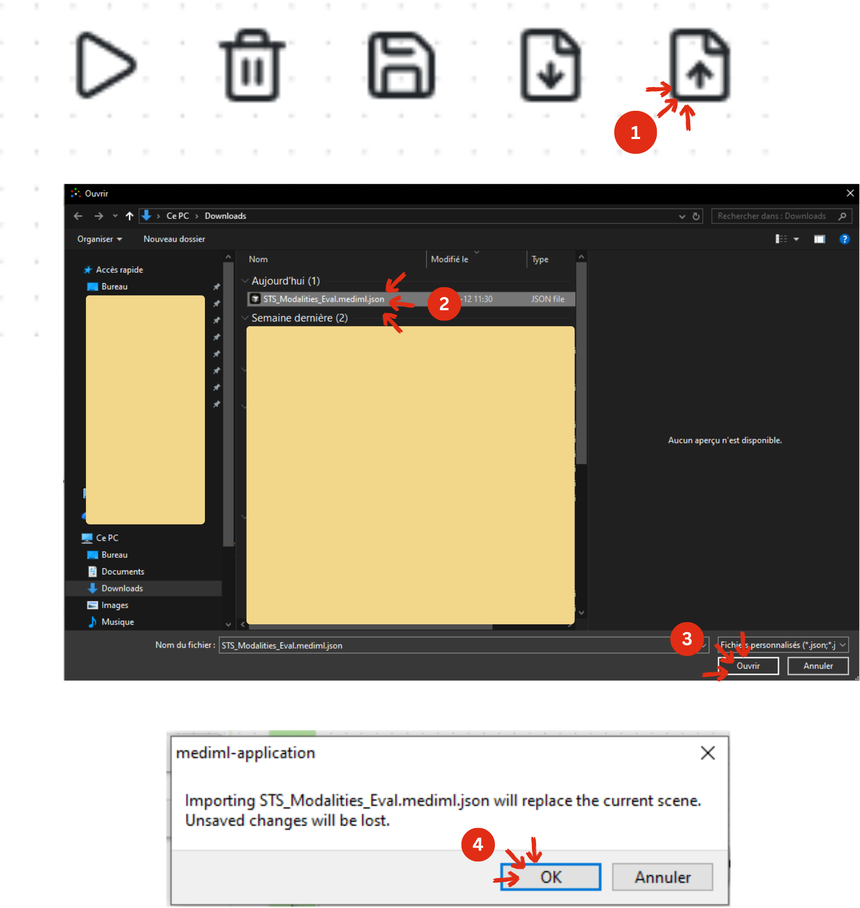<figcaption><p>How to import a scene in MEDiml</p></figcaption></figure>


**VERY CRITICAL:** Since you are importing a scene created on a different computer, the paths will most likely not match; therefore, you must absolutely redefine all the paths in the Split and Data nodes. Other nodes are affected, but make sure the configurations match (see table below).


</details>

**II. Do you prefer building it from scratch? Here is how:**

Drag the following nodes to your scene:

* Split
* Design x4 (one for each imaging modality)
* Data x4 (idem)
* Cleaning
* Normalization
* Feature Reduction
* Radiomics Learner
* Analyze

All four pipelines should be organized as follows:

```
Split → Design CT → Data CT → Clearning → Normalization → Feature Reduction → Radiomics Learner → Analysis
Split → Design PET → Data PET → Clearning → Normalization → Feature Reduction → Radiomics Learner → Analysis
Split → Design T1 → Data T1 → Clearning → Normalization → Feature Reduction → Radiomics Learner → Analysis
Split → Design T2FS → Data T2FS → Clearning → Normalization → Feature Reduction → Radiomics Learner → Analysis
```

<figure><figcaption><p>First ML scene of the POC</p></figcaption></figure>

#### Machine learning configuration


Now that your scene is ready, check the [learning module documentation](../learning.md) to learn more about the nodes used, and the[ MEDiml package documentation](https://mediml.readthedocs.io/en/latest/) to understand the configurations of these nodes.


The following tables provide the configuration used for each node in our pipeline:

| Node              | Configuration                                                                              |
| ----------------- | ------------------------------------------------------------------------------------------ |
| Split             | <p></p><p></p> |
| Design            | <p></p><p>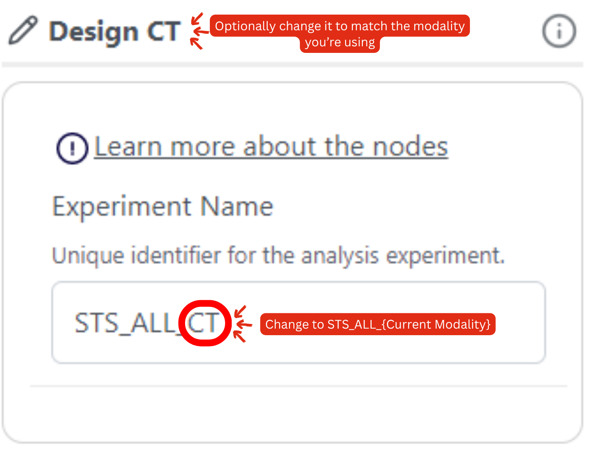</p>    |
| Data              | 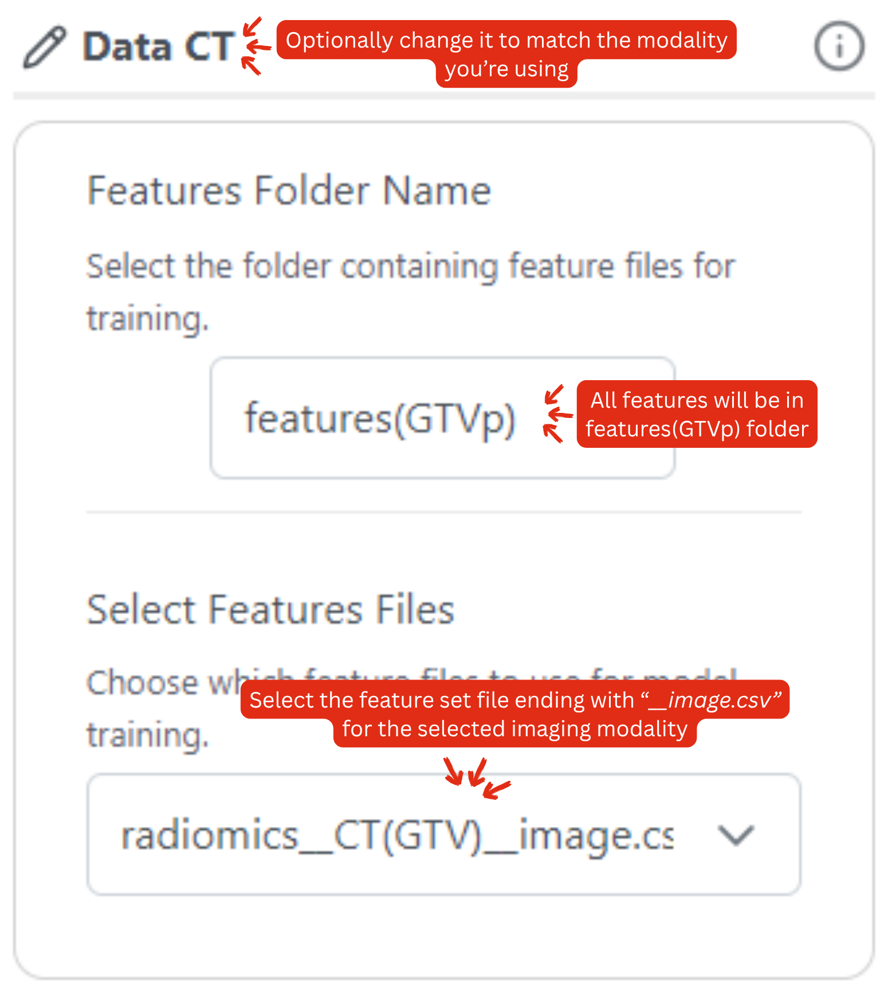                    |
| Cleaning          | No changes.                                                                                |
| Normalization     | No changes.                                                                                |
| Feature Reduction | No changes.                                                                                |
| Radiomics Learner | 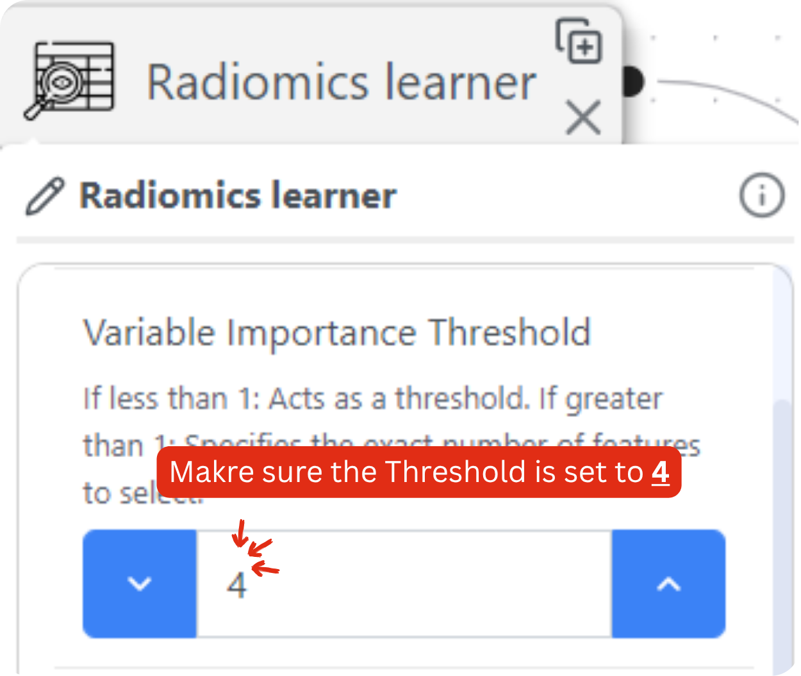  |
| Analyze           | 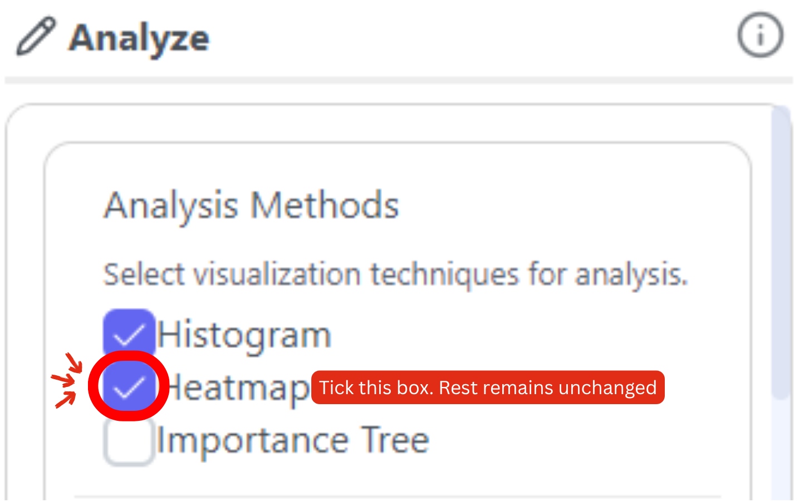                |

Do all the settings match? **Run the pipelines.**

#### Exploring the results

This section is very detrimental to understanding how results are analyzed in MEDiml. The following figure provides a comprehensive summary of the whole analysis logic:

<figure>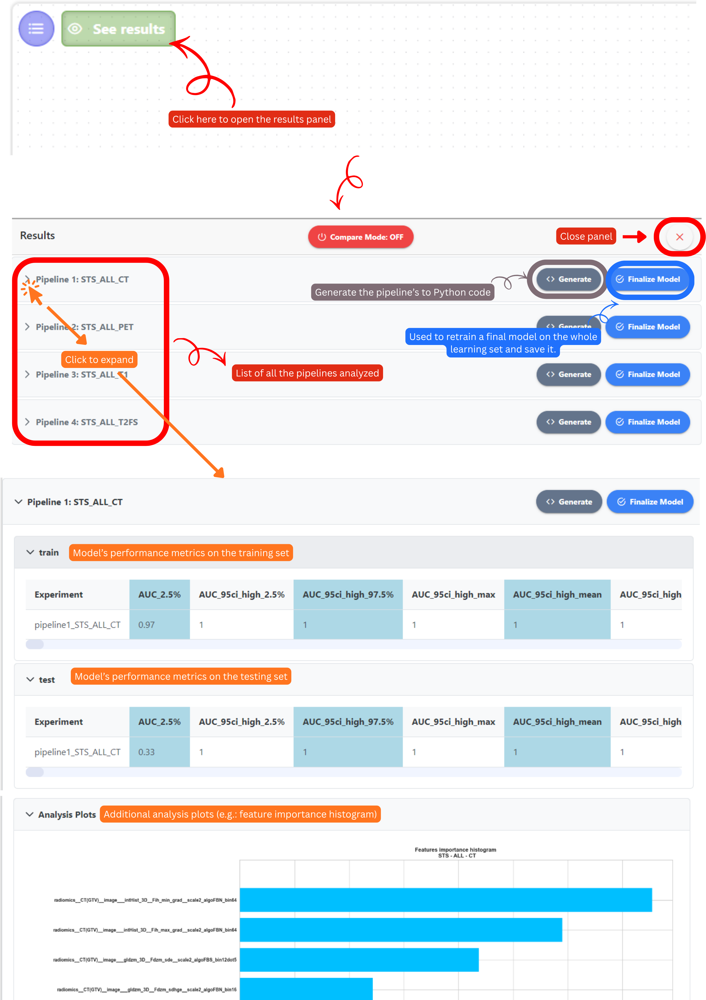<figcaption><p>MEDiml's results analysis panel</p></figcaption></figure>

**Compare Mode:**

This mode provides a better presentation of the results to enable the side-by-side comparison of the scene's pipelines, and it works as follows:

<figure>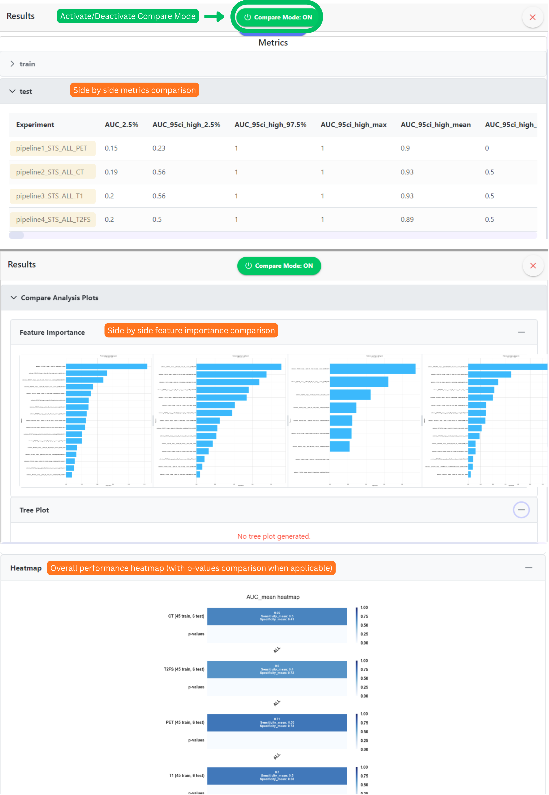<figcaption><p>MEDiml's results analysis panel compare mode</p></figcaption></figure>

#### Interpreting the Results

As shown in the overall performance heatmap, among the four imaging modalities evaluated, **PET achieved the best overall performance**, with an average **AUC of 0.71**, compared with 0.70 for T1 and 0.60 for both CT and T2FS. PET also achieved the highest **specificity (0.73)** while maintaining the highest **sensitivity (0.55)** among all modalities. This corroborates the findings of the reference study (_Vallières et al._).

Particular attention should be paid to **sensitivity**, as it measures the model's ability to correctly identify patients who will develop lung metastases (the positive class). In this clinical context, a false negative corresponds to a high-risk patient being classified as low risk. Therefore, sensitivity is especially important because it directly relates to minimizing missed metastatic cases.

The relatively higher sensitivity obtained with PET suggests that metabolic information captured by FDG uptake may provide more relevant predictive signal for metastasis risk than anatomical information alone.

<figure><figcaption><p>Heatmap comparing the predictive performance (mean AUC across 10-fold CV) across all four imaging modalities.</p></figcaption></figure>


Based on these results, **PET was selected for the subsequent feature-family comparison experiments.**


***

## Scene 2: Which Feature Family Performs Best?

After identifying the highest-performing modality, we will investigate which type of radiomic information is driving the predictions.

**Reminder: What Do These Features Describe?**

* **Morphological Features**: Describe the tumor's shape and geometric properties, such as volume, surface area, and compactness.
* **Intensity Features**: Describe how image intensity values are distributed within the tumor region.
* **Texture Features**: Describe spatial patterns and heterogeneity within the tumor, capturing relationships between neighboring voxels.

#### Building the Scene

Using the sidebar on the left, open **MEDiml Modules → Learning Module**, and enter the scene name&#x20;

```
STS_Complexity_Analysis
```

and click **Start Learning**.

**I. Download the scene (Recommended):**


If you download and import the scene, skip to the machine learning configuration section to verify if it matches the scene you imported, and make any corrections if not.




**II. Build it from scratch:**

Drag the following nodes to your scene:

* Split
* Design x3 (one for each feature family)
* Data x3 (idem)
* Cleaning
* Normalization
* Feature Reduction
* Radiomics Learner
* Analyze

All four pipelines should be organized as follows:

```
Split → Design Morph → Data Morph → Clearning → Normalization → Feature Reduction → Radiomics Learner → Analysis
Split → Design Int → Data Int → Clearning → Normalization → Feature Reduction → Radiomics Learner → Analysis
Split → Design Text → Data Text → Clearning → Normalization → Feature Reduction → Radiomics Learner → Analysis
```

<figure><figcaption><p>The second ML scene of the POC</p></figcaption></figure>

#### Machine learning configuration

In the second scene, only the Design and Data nodes have different configurations compared to our first scene:

| Node                                                     | Configuration                                                                                                                                                                                                                                          |
| -------------------------------------------------------- | ------------------------------------------------------------------------------------------------------------------------------------------------------------------------------------------------------------------------------------------------------ |
| <mark style="color:$danger;">Split (No changes)</mark>   | <p></p><p></p>                                                                                                                                                             |
| <mark style="color:$success;">Design</mark>              | <p>Use the following Experiment Names for each pipeline:<br>1. Morph pipeline: <em><strong>STS_Morph_CT</strong></em><br>2. Intensity pipeline: <em><strong>STS_Int_CT</strong></em><br>3. Texture pipeline: <em><strong>STS_Text_CT</strong></em></p> |
| <mark style="color:$success;">Data</mark>                | 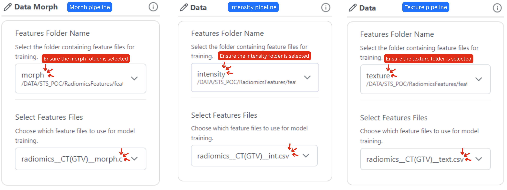                                                                                                                                                                          |
| <mark style="color:$danger;">Cleaning</mark>             | No changes.                                                                                                                                                                                                                                            |
| <mark style="color:$danger;">Normalization</mark>        | No changes.                                                                                                                                                                                                                                            |
| <mark style="color:$danger;">Feature Reduction</mark>    | No changes.                                                                                                                                                                                                                                            |
| <mark style="color:$danger;">Radiomics Learner</mark>    | No changes.                                                                                                                                                                                                                                            |
| <mark style="color:$danger;">Analyze (No changes)</mark> |                                                                                                                                                                             |

**Do all the parameters match? Run all three pipelines.**

#### Interpreting the Results

In this second heatmap, among the three groups of features compared, **Intensity features achieved the highest mean AUC (0.82)**, substantially outperforming both **Texture features (0.69)** and **Morphological features (0.53)**. Intensity features also produced the highest **sensitivity (0.65)** and **specificity (0.77)**, indicating a better overall balance between identifying high-risk patients and avoiding false alarms.

Particular attention should again be paid to **sensitivity**, as it measures the model's ability to correctly identify patients who will eventually develop lung metastases. A sensitivity of **0.65** means that approximately 65% of metastatic cases were correctly detected, making Intensity features the most effective feature family for minimizing missed high-risk patients in this experiment.

The statistical comparison further supports this observation. The difference between the **Morphological** and **Intensity** feature families was found to be statistically significant (**p = 0.034**, t-test), suggesting that the superior performance of Intensity features is unlikely to be explained by random variation alone.

<figure><figcaption><p>Heamtap of the mean AUC across the 10 CV folds for models trained using CT-based features.</p></figcaption></figure>

Overall, these results suggest that, for this dataset, **the distribution of voxel intensities within the tumor carries more predictive information about future lung metastasis than either tumor shape or texture heterogeneity alone**.&#x20;


**PET Intensity features were selected for the final algorithm-comparison experiment.**


***

## Scene 3: Comparing Learning Algorithms

The previous experiments used [**PyCaret's Best Model**](https://pycaret.readthedocs.io/en/stable/api/classification.html#pycaret.classification.compare_models) option to automatically select the strongest algorithm. In this final comparison, we evaluate several widely used machine-learning approaches on the highest-performing feature family identified in Scene 2:

**Logistic Regression (LR):** A simple and highly interpretable linear model that serves as a strong baseline in many biomedical studies.

**XGBoost:** A gradient-boosted decision-tree algorithm widely recognized for its strong performance on tabular datasets.

**Best Model:** MEDiml's automated model-selection workflow, which evaluates multiple candidate algorithms and selects the top performer.


Note that this test assumes that the best-performing model was neither XGBoost nor Logistic Regression. In our previous tests, the K-nearest-neighbour was selected as the best.


#### Building the Scene

Using the sidebar on the left, open **MEDiml Modules → Learning Module**, and enter the scene name&#x20;

```
STS_Algorithms_Analysis
```

and click **Start Learning**.

**I. Download the scene (Recommended):**


Again, if you download and import the scene, skip to the machine learning configuration section to verify that it matches the scene you imported, and make any corrections if it does not.




**II. Build it from scratch:**

Drag the following nodes to your scene:

* Split
* Design x3 (one for each machine algorithm)
* Data x3 (idem)
* Cleaning x3 (idem)
* Normalization x3 (idem)
* Feature Reduction x3 (idem)
* Radiomics Learner x3 (idem)
* Analyze

All four pipelines should be organized as follows:

```
Split → Design XGBoost → Data Int → Clearning → Normalization → Feature Reduction → Radiomics Learner → Analysis
Split → Design LR → Data Text → Clearning → Normalization → Feature Reduction → Radiomics Learner → Analysis
Split → Design Best → Data Morph → Clearning → Normalization → Feature Reduction → Radiomics Learner → Analysis
```

<figure><figcaption><p>Third and final machine learning scene of the POC</p></figcaption></figure>

#### Machine learning configuration

In this final scene, the following nodes require changes from the default settings:

| Node                                                     | Configuration                                                                                                                                                                                                                                                |
| -------------------------------------------------------- | ------------------------------------------------------------------------------------------------------------------------------------------------------------------------------------------------------------------------------------------------------------ |
| <mark style="color:$success;">Split</mark>               | 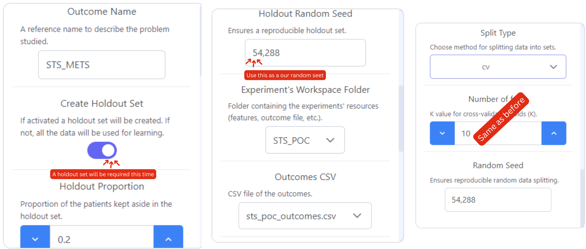                                                                                                                                                                              |
| <mark style="color:$success;">Design</mark>              | <p></p><p>Use the following Experiment Names for each pipeline:<br>1. XGBoost pipeline: <em><strong>STS_XGBoost_CT</strong></em><br>2. LR pipeline: <em><strong>STS_LR_CT</strong></em><br>3. Best model pipeline: <em><strong>STS_BEST_CT</strong></em></p> |
| <mark style="color:$success;">Data</mark>                |                                                                                                                                                                                       |
| <mark style="color:$danger;">Cleaning</mark>             | No changes.                                                                                                                                                                                                                                                  |
| <mark style="color:$danger;">Normalization</mark>        | No changes.                                                                                                                                                                                                                                                  |
| <mark style="color:$danger;">Feature Reduction</mark>    | No changes.                                                                                                                                                                                                                                                  |
| <mark style="color:$success;">Radiomics Learner</mark>   | 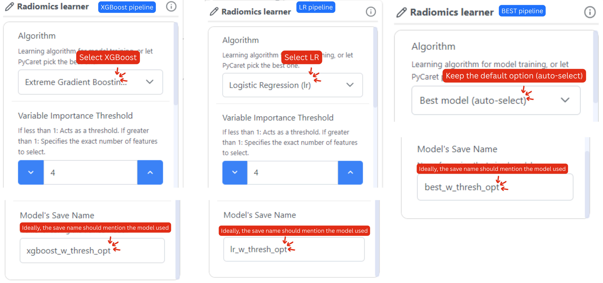                                                                                                                                                                    |
| <mark style="color:$danger;">Analyze (No changes)</mark> |                                                                                                                                                                                   |

Run all three pipelines and compare their performance.

#### Choosing the Final Model

The final experiment compared three learning strategies using the highest-performing feature set identified in the previous analyses: **PET Intensity features**.

Among the evaluated approaches, **Logistic Regression (LR)** achieved the highest mean performance, reaching an **AUC of 0.71**, compared with **0.55** for XGBoost and **0.53** for the automated **Best Model** strategy. Logistic Regression also achieved the highest **specificity (0.83)** while maintaining a reasonable **sensitivity (0.45)**.

<figure><figcaption></figcaption></figure>

It is important to note that all models experienced a decrease in performance compared to the previous experiment, where PET Intensity features achieved a mean AUC of 0.82. This reduction is expected because a portion of the dataset was now reserved as an independent **holdout set** for final evaluation. As a result, fewer samples were available during training, increasing estimation difficulty and providing a more realistic assessment of model performance on unseen data.

Although Logistic Regression achieved the highest AUC, its sensitivity remained moderate (**0.45**), indicating that some patients who eventually developed lung metastases were still missed by the model. Nevertheless, Logistic Regression provided the best overall balance between discrimination ability and generalization performance in this experiment.

Interestingly, the automated **Best Model** strategy did not outperform Logistic Regression. Inspection of the individual cross-validation folds revealed that the model selected by PyCaret's `compare_models()` procedure varied considerably from one fold to another. This behavior likely reflects the relatively small dataset size and the resulting instability of model rankings across different training subsets. When the available data are limited, small changes in sample composition can substantially affect performance estimates, causing different algorithms to emerge as the best performer in different folds.

While the difference in mean AUC between Logistic Regression and the other approaches appears substantial, the corresponding statistical comparison did not reach the conventional significance threshold (**p = 0.222**). A likely explanation is the limited sample size and the variability observed across folds. Statistical tests evaluate not only the difference in means but also the variability of the measurements; consequently, a large average performance difference may still fail to achieve statistical significance when uncertainty is high.

Based on these results, **Logistic Regression was selected as the final model** for this proof of concept.&#x20;

## Finalize Model

To finalize a model for a given pipeline, click "See results", then click "Finalize Model" next to the selected pipeline: `STS_LR_CT` in our case.

<figure>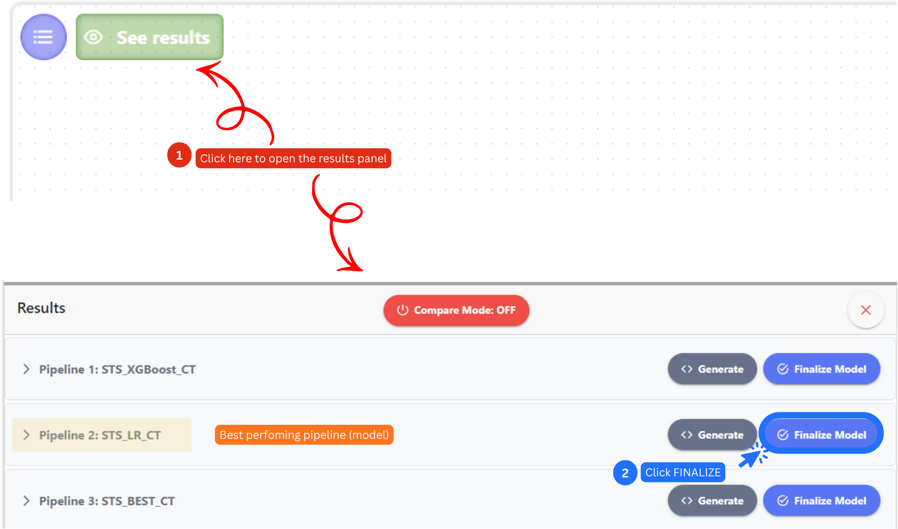<figcaption><p>How to finalize the best perfoming model/pipeline.</p></figcaption></figure>

This process will retrain the selected Logistic Regression model using the entire learning dataset, maximizing the amount of information available for learning before performing the final evaluation on the untouched holdout set.

See you at the final phase, where we will analyze and discuss the final results. We're almost at the end:clap:!
