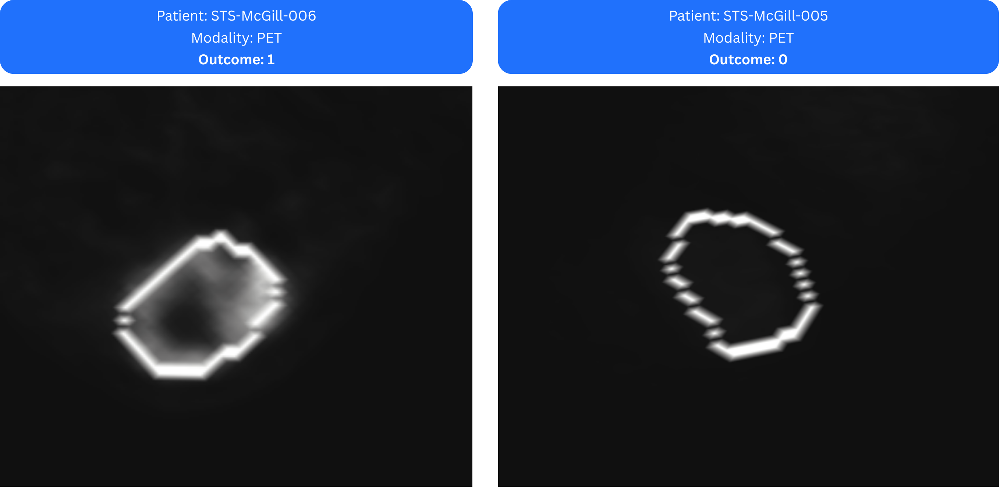

# 5. Results Analysis & Discussion

## Feature Importance Analysis

One advantage of Logistic Regression is that it provides a relatively interpretable model. By examining the learned coefficients, we can identify which radiomic features contributed most to the prediction of lung metastasis.

<figure><figcaption>
Feature importance histogram for the finalized logistic regression model
</figcaption></figure>

The feature-importance analysis reveals that the model relies predominantly on a small group of **first-order intensity features**, including:

* **Median intensity**
* **Mean intensity**
* **90th percentile intensity**
* **Local intensity peak**
* **Energy**
* **Quartile coefficient of dispersion (QCOD)**
* **Kurtosis**

Notably, the two most influential features were the **median** and **mean intensity**, which contributed substantially more than the remaining variables.

### Biological Interpretation

The visual comparison below helps illustrate why **PET intensity features** emerged as the strongest predictors of metastasis risk in this POC.

<figure><figcaption></figcaption></figure>

The patient who subsequently developed lung metastases (**Outcome = 1**, left) exhibits a markedly **higher and more heterogeneous FDG uptake pattern** within the tumor contour. In contrast, the non-metastatic patient (**Outcome = 0**, right) demonstrates substantially lower overall uptake, with a more uniform intensity distribution.

These differences are precisely what the top-ranked radiomic features were designed to quantify:

#### **1. Median and Mean Intensity**

These features summarize the overall intensity level within the tumor.

In CT imaging, intensity values are related to tissue density. Variations in average tumor density may reflect underlying biological processes such as:

* Cellularity
* Necrosis
* Fibrosis
* Matrix composition
* Tumor vascularization

The strong contribution of these features suggests that the global tissue composition of the tumor may be associated with metastatic potential.

#### 2. 90th Percentile Intensity

The 90th percentile captures the highest-density regions within the tumor while remaining less sensitive to isolated outliers than the maximum value.

These highly attenuating regions may correspond to localized areas of increased cellular density, fibrosis, mineralization, or other structural alterations associated with aggressive tumor phenotypes.

#### 3. Local Intensity Peak

This feature measures the highest average intensity observed within a small neighborhood of voxels.

Unlike a simple maximum intensity, the local peak identifies spatially consistent regions of elevated density, potentially reflecting biologically distinct subregions within the tumor.

In conclusion, **global intensity characteristics may be more informative than shape descriptors or texture patterns for identifying patients at risk of developing lung metastases**.

***

### Comparison with the Reference Study

An interesting observation is that these findings partially differ from those reported by [Vallières et al.](https://iopscience.iop.org/article/10.1088/0031-9155/60/14/5471), whose final model was based primarily on a small set of **texture features** extracted from combined PET and MRI data.

In contrast, the simplified MEDiml workflow identified **intensity-based features** as the dominant source of predictive information.

Several factors may explain this difference:

* The original study used multimodal PET-MRI feature fusion rather than a single modality.
* Extensive parameter optimization was performed in the original work.
* A much larger radiomic search space was explored.
* Different feature-selection strategies were employed.

Nevertheless, both studies converge on an important observation: logistic regression outperformed other models, and **quantitative imaging characteristics contain measurable information related to future metastatic risk**. Whether this information is ultimately captured by intensity descriptors or texture descriptors appears to depend strongly on the extraction settings, feature-selection strategy, and modeling pipeline used.

#### Key Takeaway

The feature-importance analysis suggests that the finalized model primarily relies on **tumor intensity distribution characteristics**, indicating that differences in overall tissue composition, density distribution, and intratumoral intensity variability may be associated with the development of lung metastases in patients with soft-tissue sarcoma.
