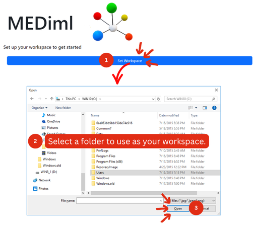
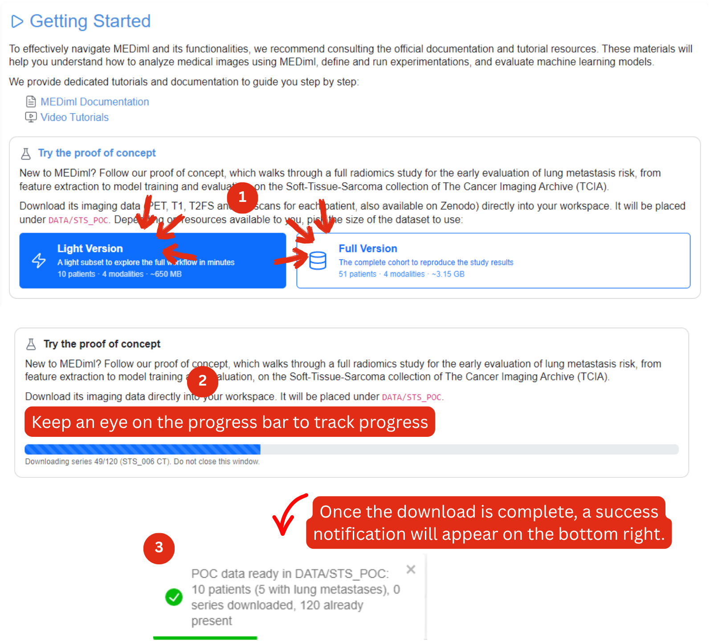
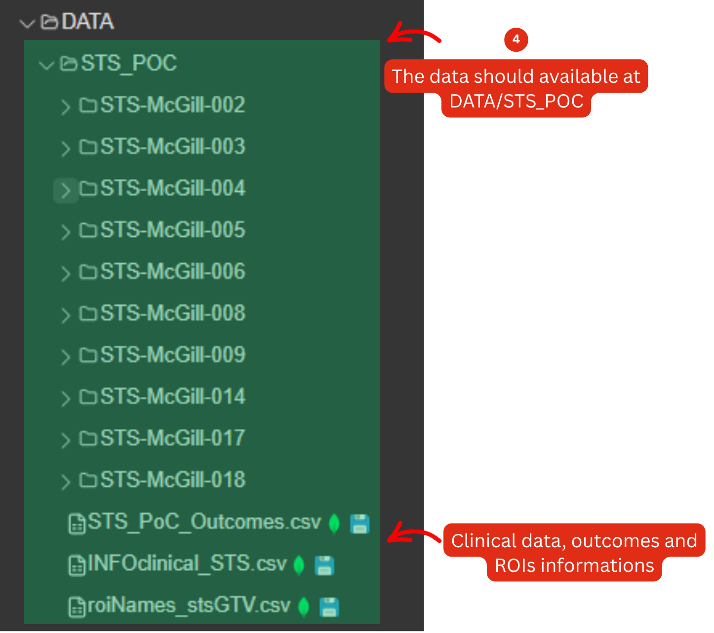

# Soft Tissue Sarcoma POC


For smoother testing, the [troubleshooting page](../troubleshooting.md) is there to assist you.



If reading isn't your favorite part, don't worry. This POC was designed so you can easily follow along by looking at the figures alone.


This POC introduces the MEDiml platform through a real-world radiomics application: **predicting the risk of lung metastasis in patients with soft-tissue sarcoma (STS)** using pre-treatment medical imaging.

Throughout the workflow, you will discover how MEDiml supports the complete radiomics pipeline, including:

* Medical image exploration and visualization
* Tumor segmentation management
* Image preprocessing
* Radiomics feature extraction
* Machine learning model development
* Comparative analysis of predictive performance

By the end of the POC, you will have trained and evaluated predictive models using radiomics features extracted from multiple imaging modalities and explored which imaging biomarkers contribute most to metastasis prediction.

## Predictive Modeling Objective

The objective of this POC is to predict the development of **lung metastases** using radiomics features extracted from four pre-treatment imaging modalities:

* CT
* FDG-PET
* T1-weighted MRI
* T2-weighted fat-suppressed MRI (T2FS)

In addition to training predictive models, we will investigate:

* Which imaging modality contains the strongest predictive signal
* Which radiomics feature family contributes most to prediction:
  * Morphological (shape-based)
  * Intensity-based
  * Texture-based
* How our findings compare with those reported by:

> Vallières M. et al. (2015), _A radiomics model from joint FDG-PET and MRI texture features for the prediction of lung metastases in soft-tissue sarcomas of the extremities_, _Physics in Medicine and Biology_, 60(14), 5471–5496. [(PMID 26119045)](https://iopscience.iop.org/article/10.1088/0031-9155/60/14/5471).

## What Is Radiomics?

Radiomics is the process of converting medical images into quantitative measurements that describe characteristics such as tumor shape, intensity patterns, and internal texture. These measurements can then be used for statistical analysis and machine learning.


Interested in learning more? See the [radiomics introduction page](../radiomics/).


### About the Dataset

This POC uses data from the **Soft-Tissue-Sarcoma (STS) Collection** available through **The Cancer Imaging Archive (TCIA)**.

The dataset contains pre-treatment multimodal imaging from **51 patients** with histologically confirmed soft-tissue sarcomas of the extremities. Available imaging modalities include:

* FDG-PET
* CT
* T1-weighted MRI
* T2-weighted fat-suppressed MRI (T2FS)

During clinical follow-up, **19 of the 51 patients developed lung metastases**, making this dataset suitable for predictive modeling studies.

Expert-defined three-dimensional tumor segmentations are also provided as DICOM RTSTRUCT files. Tumors were manually delineated on T2FS MRI and transferred to the remaining modalities through image registration.

For some patients, two regions of interest (ROIs) are available:

* **GTV\_Mass**: tumor mass only
* **GTV\_Edema**: tumor mass combined with surrounding edema


**Data Origin:** Vallières M. et al. (2015). _A radiomics model from joint FDG-PET and MRI texture features for the prediction of lung metastases in soft-tissue sarcomas of the extremities._ _Physics in Medicine and Biology_, 60(14), 5471–5496. doi:10.1088/0031-9155/60/14/5471.


### The Clinical Problem

Soft-tissue sarcomas (STSs) are a heterogeneous group of rare malignancies of mesenchymal origin, most commonly occurring in the extremities. Despite effective local treatment, approximately 25% of patients develop distant metastases, with the risk reaching about 50% for high-grade tumors ([Billingsley et al., 1999](https://doi.org/10.1002/\(SICI\)1097-0142\(19990115\)85:2%3C389::AID-CNCR17%3E3.0.CO;2-J); [Brennan, 2005](https://doi.org/10.1016/s1479-666x\(05\)80044-7)). In this POC, handcrafted radiomics features extracted from pre-treatment medical images are used to predict the development of lung metastases. A balanced subset of 10 patients is used for the machine-learning demonstration, comprising 5 patients who developed lung metastases and 5 who did not.

#### **Light POC or Full POC?**

Since the imaging data is relatively large, MEDiml provides two versions of the POC dataset.

_**Light POC?**_ Recommended for first-time users, software demonstrations, and learning the MEDiml workflow. it includes:

* 10 patients
* 4 imaging modalities per patient
* Approximately 650 MB

Dataset composition:

* 5 patients who developed lung metastases
* 5 patients who did not

_**Full POC?**_ Recommended for scientific exploration and more representative machine-learning experiments. It includes:

* 51 patients
* 4 imaging modalities per patient
* More than 3 GB of imaging data

Dataset composition:

* 19 patients with lung metastases
* 32 patients without lung metastases

The choice between the Light and Full POC should be mainly guided by your **available computing resources**.

## The Clinical Problem

Soft-tissue sarcomas (STSs) are a rare and heterogeneous group of cancers arising from mesenchymal tissues such as muscle, fat, and connective tissue.

While many patients can be successfully treated locally through surgery and/or radiotherapy, a substantial proportion eventually develop distant metastases, most commonly in the lungs. Accurately identifying high-risk patients before treatment remains an important clinical challenge.

In this POC, radiomics features extracted from pre-treatment medical images are used to develop machine-learning models that predict whether a patient will subsequently develop lung metastases.

### Downloading The Data


Might sound obvious, but you need internet to download the POC data!


The good news is that MEDiml automatically downloads, organizes, and prepares all datasets required for this POC. Simply follow these steps:

* Set up your workspace to get started. _Don't know how? No worries, follow the steps in the figure below:_

<figure><figcaption>
How to choose a workspace folde in MEDiml
</figcaption></figure>

* Select Light or Full POC, click the Download button, and wait for the download to complete (Full POC might take a while). MEDiml will automatically retrieve the data and organize it within:

<figure><figcaption></figcaption></figure>

Once the download is complete, you can proceed to the next section.

#### Exploring the Downloaded Content

Before performing any analysis, it is worth taking a few minutes to explore the downloaded data.

Within the workspace, the dataset is organized as follows:

<figure><figcaption></figcaption></figure>

**Patient Folders**

Each patient folder contains four imaging modalities:

<figure><figcaption></figcaption></figure>

Each modality folder contains:

* DICOM image files
* Associated RTSTRUCT segmentations

**Outcome File (**`sts_poc_outcomes.csv`**)**

Contains the binary outcome used throughout the machine-learning workflow.

| Outcome | Meaning            |
| ------- | ------------------ |
| 0       | No lung metastasis |
| 1       | Lung metastasis    |

This file serves as the ground-truth label for all predictive modeling experiments.

**ROI Definition File (**`roiNames_stsGTV.csv`**)**

Specifies which tumor ROI should be used for each patient during batch radiomics extraction.

The file provides a standardized ROI definition, ensuring that all patients are processed consistently throughout the POC.

**Clinical Data File (**`INFOclinical_STS.csv`**)**

Contains clinical and pathological information, including variables such as:

* Age
* Sex
* Histological subtype
* Tumor grade
* Treatment information
* Follow-up information

These variables are **not used in this POC**, but users are encouraged to explore them and compare clinical characteristics with model predictions.

_YOU ARE NOW READY FOR THE REAL STUFF_ :fire:_!_



### [Single Scan Extraction](1.-single-scan-extraction.md)

Test how different image-processing and radiomics settings affect the processed images and extracted features.



### [DataManager: Radiomics pre-checks](./#datamanager-radiomics-pre-checks)

Test how different image-processing and radiomics settings affect the processed images and extracted features.



### [BatchExtractor](3.-batchextractor.md)

Apply the selected settings to extract radiomics features from the entire dataset.



### [Learning Module](4.-learning-module.md)

Create multiple pipelines to train and evaluate classification models and identify the best-performing approach.



### [Results Analysis & Discussion](5.-results-analysis-and-discussion.md)&#x20;

Train and evaluate the final selected model, analyze and discuss the findings and how they relate to the biology of the soft tissue sarcomas.


