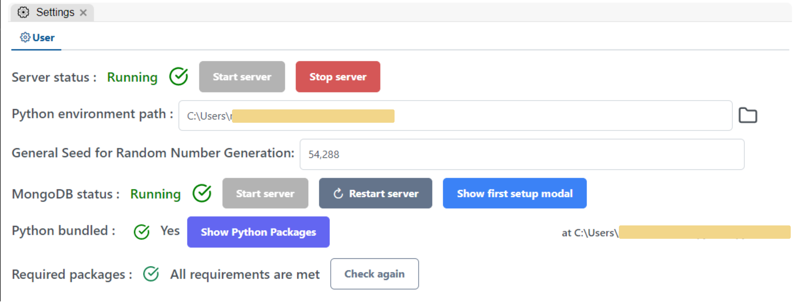
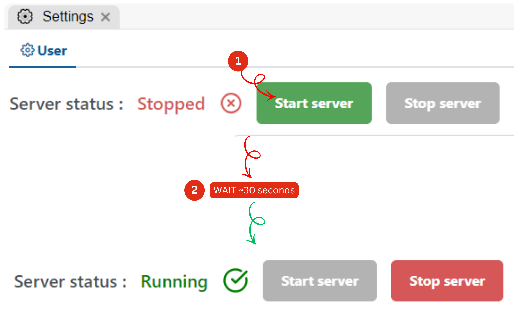
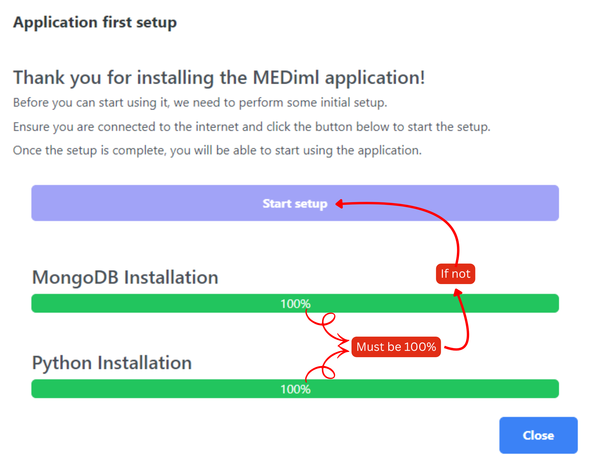
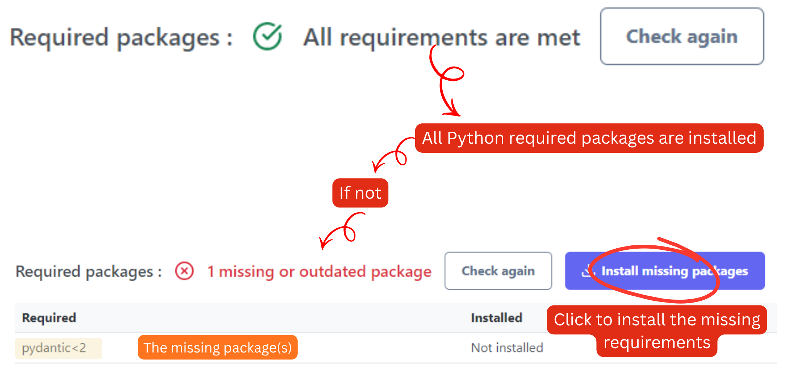
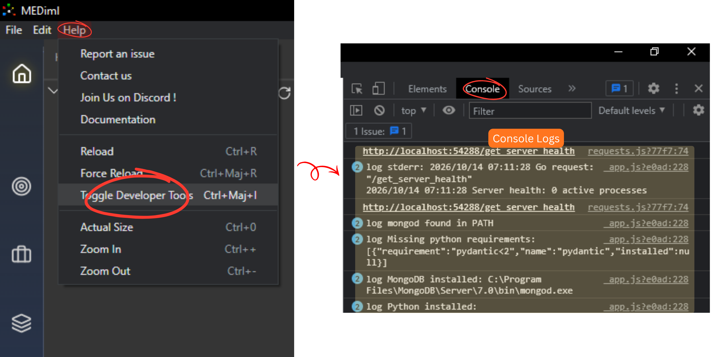
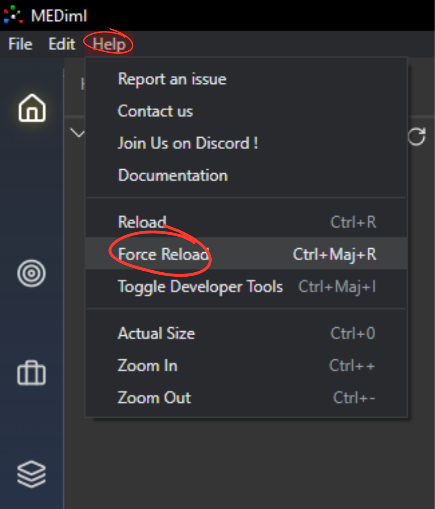

# Troubleshooting

## Common Errors and Troubleshooting

This page documents the most common issues encountered when using MEDiml and the recommended steps to resolve them.

#### The Settings Page: Your First Diagnostic Tool

The **Settings** page is the central diagnostic page of the application. Whenever MEDiml is not behaving as expected, this should be the first place you visit.

<figure><figcaption>
MEDiml's settings page
</figcaption></figure>

#### Red Dot on the Settings Icon

A **red dot** displayed on the Settings icon indicates that one or more critical services or requirements are not configured correctly.

<figure><figcaption>
Settings icon red dotted
</figcaption></figure>

When this occurs:

1. Open the **Settings** page.
2. Review all status indicators.
3. Resolve any warnings or errors before continuing.

#### Go Server Status


**Expected Status:** ✅ **Running**


The **Go Server** is responsible for communication between the graphical interface and the MEDiml backend.

**If the Server Is Not Running:**

1. Open the **Settings** page.
2. Click **Start Server**.
3. Wait until the status changes to **Running**.

<figure><figcaption>
How to start the Go server
</figcaption></figure>

If the server does not start:

* Wait at least **60 seconds**.
* Click **Start Server** again.
* Repeat the process a few times if necessary.

#### Still Not Working?

If the status never changes to **Running**, please [contact the MEDiml team](forms/contact-us.md) and provide any error messages available in the developer console.

#### Python Environment Path

The **Python Environment Path** setting must never be empty.


**Expected Value:** The path should point to the bundled Python environment located inside the .mediml folder created during installation.


**Common Symptoms**

* Extraction jobs fail immediately.
* Learning pipelines do not start.
* Package installation errors appear.

**Resolution**

If the path is empty or invalid:

1. Open the **Settings** page.
2. Launch the **First Setup** wizard (see below).
3. Reinstall or reconfigure the bundled environment.

#### MongoDB Server

MEDiml uses MongoDB for internal data management.


Expected Status: ✅ Running


**If MongoDB Is Not Running**

1. Open the **Settings** page.
2. Click **Restart Server**.
3. Wait for the status to change to **Running**.

If needed:

* Wait at least **60 seconds** between attempts.
* Retry several times.

If the problem persists, [contact](forms/contact-us.md) the MEDiml team.

### First Setup Modal

The **Show First Setup Modal** option can be used at any time to rerun the initial installation procedure.

**Use the First Setup Wizard If:**

* Python installation failed.
* MongoDB installation failed.
* Python or MongoDB was accidentally deleted.
* A system update damaged the installation.
* The bundled environment is missing.
* You are unsure whether the installation completed successfully.

<figure><figcaption>
MEDiml's first setup wizard
</figcaption></figure>

Running the wizard will reinstall and reconfigure the required components.

#### Python Bundled Status


Expected Status: ✅ Yes


**If the Status Is "No"**

The bundled Python installation is missing or could not be detected.

**Resolution**

Launch the **First Setup Wizard** and reinstall the bundled environment.

***

### Required Packages

MEDiml depends on several Python packages to perform feature extraction, machine learning, and data processing.


Expected Status: ✅ All requirements are met


**If Packages Are Missing**

1. Open the **Settings** page.
2. Locate the **Required Packages** section.
3. Click **Install**.
4. Wait for the installation to complete.

<figure><figcaption>
How to ensure all python packages are installed
</figcaption></figure>

The status should return to: **All requirements are met** before running any workflows.

***

### Viewing Developer Logs

When troubleshooting a problem, additional information can be obtained through the developer tools.

**Open Developer Tools**

1. Click **Help** in the application's top menu bar.
2. Select **Toggle Developer Tools**.
3. Open the **Console** tab.

<figure><figcaption>
How to check the logs' console
</figcaption></figure>

**Why This Helps**

The console displays:

* Application errors
* Backend communication errors
* Python execution errors
* Package installation failures
* Startup and initialization issues

Sharing these messages with the MEDiml team can significantly speed up issue diagnosis and resolution.

***

### If the Application Freezes

Occasionally, the graphical interface may stop responding.

**Force Reload the Application**

1. Click **Help** in the top menu bar.
2. Select **Force Reload**.

<figure><figcaption>
How to force reload MEDiml
</figcaption></figure>

This reloads the interface without requiring a full application restart and often resolves temporary UI issues.

***

### Still Experiencing Issues?

If none of the above solutions resolve the problem:

1. Verify all statuses in the **Settings** page.
2. Open the **Developer Tools Console** and collect any error messages.
3. Take screenshots when possible.
4. [Contact the MEDiml team](forms/contact-us.md) with the collected information.

The more details you provide, the faster the issue can be diagnosed and resolved.
